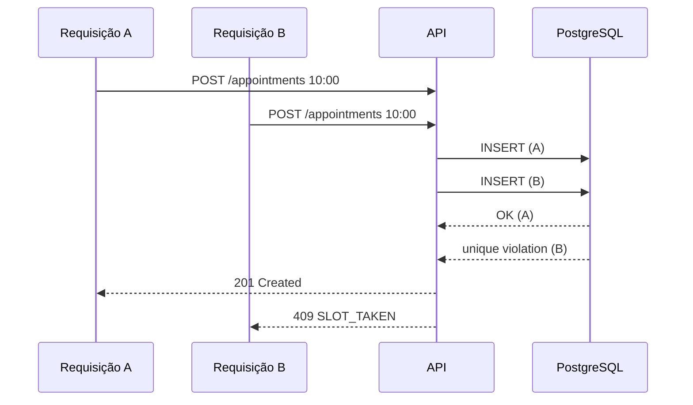
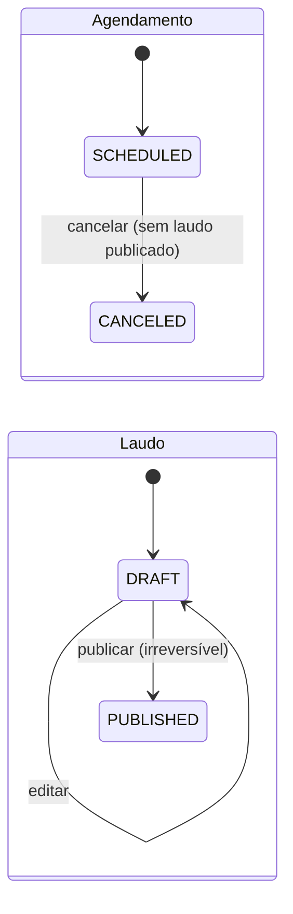
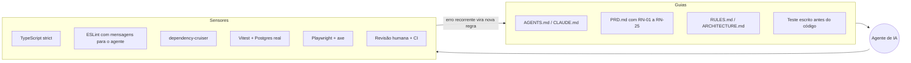

# Dr. Laudo — Agendamento de exames e laudos

> Do agendamento ao laudo, sem complicação.

Projeto **fictício** desenvolvido como desafio técnico. Todos os dados são de demonstração.

> **Estado atual:** preparação documental. A aplicação e a infraestrutura ainda serão implementadas; os comandos abaixo descrevem a execução prevista. Consulte o [estado da preparação técnica](docs/STATUS.md).

**Demo:** https://drlaudo.seudominio.com.br  ·  **Stack:** React + TypeScript · Node + Fastify · PostgreSQL

---

## Rodar em 1 comando (só Docker)

```bash
git clone <repo> && cd agendamento-exames-laudos
docker compose up --build
```

Abra http://localhost:8080. Não precisa de `.env`: migrations e seed rodam sozinhos.

| Perfil | E-mail | Senha |
|---|---|---|
| Equipe | `equipe@drlaudo.test` | `Demo@1234` |
| Paciente | `ana.souza@drlaudo.test` | `Demo@1234` |
| Paciente | `bruno.lima@drlaudo.test` | `Demo@1234` |

## Rodar os testes (só Docker)

```bash
docker compose -f docker-compose.qa.yml run --rm api-test   # unitário + integração
docker compose -f docker-compose.qa.yml run --rm e2e        # Playwright + acessibilidade
docker compose -f docker-compose.qa.yml down -v
```

O QA usa um projeto Compose separado (`drlaudo-qa`), com banco em memória e sem portas expostas. A demo não é afetada.

## Rodar sem Docker (Node 22+ e PostgreSQL 14+)

```bash
cp .env.example .env      # ajuste DATABASE_URL e DATABASE_URL_TEST
npm install
npm run db:setup
npm run dev               # api :3333 | web :5173
npm test
```

Modo híbrido: `docker compose up -d db` sobe só o Postgres (porta 5433) e o resto roda com `npm run dev`.

---

## Os 5 cenários exigidos e onde estão provados

| # | Cenário | Teste de integração | E2E |
|---|---|---|---|
| 1 | Dois agendamentos simultâneos no mesmo horário → um 201, um 409 | `appointments.concurrency.test.ts` | `staff.scheduling.spec.ts` |
| 2 | Paciente não acessa dados de outro paciente → 404 | `patient.access.test.ts` | `patient.access.spec.ts` |
| 3 | Laudo em rascunho invisível ao paciente | `patient.access.test.ts` | `patient.access.spec.ts` |
| 4 | Laudo publicado visível ao paciente | `patient.access.test.ts` | `patient.access.spec.ts` |
| 5 | Agendamento no passado → 422 `PAST_DATE` | `appointments.create.test.ts` | `staff.scheduling.spec.ts` |

## Como a concorrência é resolvida

Verificar se o horário está livre antes de inserir **não** protege contra duas requisições simultâneas. Quem garante é o banco:

```sql
CREATE UNIQUE INDEX "appointment_active_slot_unique"
  ON "Appointment" ("startsAt") WHERE "status" = 'SCHEDULED';
```



Cancelar e publicar ao mesmo tempo alteram tabelas diferentes, então um `updateMany` condicional não impede o *write skew*. As duas operações bloqueiam a linha do agendamento com `SELECT ... FOR UPDATE` (ver `docs/DECISIONS.md`, D-05).

## Estados



## Desenvolvimento assistido por IA (harness)

O projeto foi construído com Claude Code/Codex dentro de um **harness**: guias que orientam o agente antes de ele agir e sensores que verificam depois.



- Como funciona: [`docs/HARNESS.md`](docs/HARNESS.md)
- Erros reais da IA e como foram corrigidos: [`docs/AI_USAGE.md`](docs/AI_USAGE.md)

## Regras do projeto — comece aqui

- **O que o avaliador pede:** [enunciado original do desafio (PDF)](teste-agendamento-exames-laudos.pdf), preservado no repositório.
- **Requisitos e regras de negócio organizados:** [PRD](docs/PRD.md), com RF-01 a RF-08 e RN-01 a RN-25.
- **Como implementar:** [RULES](docs/RULES.md), com as convenções de código, segurança e testes.
- **Como os agentes devem trabalhar:** [AGENTS.md](AGENTS.md), incluindo as invariantes.
- **O que fazer e como comprovar:** [TASKS](docs/TASKS.md) e [TESTING](docs/TESTING.md).

O PDF é a fonte primária. PRD, decisões e contratos detalham sua implementação; não substituem as exigências originais. O [estado do projeto](docs/STATUS.md) separa documentação pronta de implementação pendente. A entrega também deve informar o tempo aproximado dedicado ao exercício, registrado em [AI_USAGE](docs/AI_USAGE.md#tempo-dedicado-ao-exercício).

## Documentação

| Doc | Conteúdo |
|---|---|
| [Enunciado original (PDF)](teste-agendamento-exames-laudos.pdf) | Documento original do desafio e exigências de entrega |
| [Estado do projeto](docs/STATUS.md) | Preparação documental, arquivos entregues e pendências |
| [PRD](docs/PRD.md) | Requisitos e regras de negócio |
| [Regras de código](docs/RULES.md) | Convenções obrigatórias de implementação |
| [Instruções dos agentes](AGENTS.md) | Fluxo de trabalho e invariantes |
| [API](docs/API.md) | Contrato HTTP |
| [Arquitetura](docs/ARCHITECTURE.md) | Camadas, dados, fluxos, deploy |
| [Decisões](docs/DECISIONS.md) | O que foi decidido e por quê |
| [Testes](docs/TESTING.md) | Estratégia, cenários, QA |
| [Design System](docs/DESIGN_SYSTEM.md) | Marca, tokens, componentes |
| [Tarefas](docs/TASKS.md) | Plano e critérios de aceite |
| [Harness](docs/HARNESS.md) | Guias e sensores para uso de IA |
| [Uso de IA](docs/AI_USAGE.md) | Histórico, revisão e tempo dedicado ao exercício |

## Fora do escopo (evoluções naturais)

PDF do laudo, anexos, visualizador DICOM (Cornerstone3D/OHIF), recuperação de senha, múltiplas salas/equipamentos, notificações e tema escuro.
