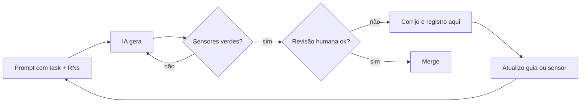

# Uso de IA — Dr. Laudo

**Autoridade:** [enunciado](DESAFIO.md), §§2 e 5 → [PRD](PRD.md). Regras compartilhadas: [AGENTS](../AGENTS.md).

Histórico inicial fornecido pela Zaíra: chat de planejamento/documentação. Rodada atual: OMP/Kisha, organização das regras e especificação técnica com Felipe, Bruno e Tina. Não há execução de aplicação comprovada; sessões, logs e roteiros pessoais não são material de entrega.

## Princípios

1. A IA escreve; eu entendo, reviso e testo. Nada entra sem que eu saiba explicar.
2. Teste primeiro: o teste define o comportamento, a IA implementa.
3. Erro recorrente vira guia (AGENTS/RULES) ou sensor (lint/teste), não só correção pontual.
4. Os cinco cenários vêm de DESAFIO §4.4. Ainda não há testes implementados/executados no repositório; referências a cenários nos registros de planejamento não são resultados.

## Loop de condução

## Registro

Modelo de entrada:

> **#NN — título** · data · ferramenta · task
> **Pedido:** ...
> **O que a IA fez:** ...
> **Problema:** ...
> **Correção:** ...
> **Virou:** (regra/teste/lint) ...

---

**#01 — Conflito de horário com SELECT antes do INSERT** · planejamento · chat · T-08
**Pedido:** estratégia para impedir dois agendamentos no mesmo horário.
**O que a IA fez:** sugeriu consultar se existia agendamento no horário e só então inserir.
**Problema:** duas requisições simultâneas passam juntas pela consulta e as duas inserem (race condition).
**Correção:** índice único parcial `ON "Appointment"("startsAt") WHERE status = 'SCHEDULED'`; `P2002` → 409.
**Virou:** invariante 1 do `AGENTS.md` + cenário 1 com `Promise.all` real + D-04.

**#02 — `updateMany` condicional contra cancelar × publicar** · planejamento · chat · T-10/T-11
**Pedido:** evitar agendamento cancelado com laudo publicado.
**O que a IA fez:** propôs `updateMany` com condição de status em cada operação, como se isso impedisse a corrida.
**Problema:** erro da IA: as operações alteram tabelas diferentes; no READ COMMITTED as duas podem passar juntas (write skew).
**Correção:** `$transaction` + `SELECT ... FOR UPDATE` na linha do agendamento nas duas operações.
**Virou:** invariante 2 + teste de corrida repetido 20× + D-05.

**#03 — E-mails demo em domínio real** · planejamento · chat · seed
**O que a IA fez:** usou `@demo.com`.
**Problema:** é um domínio real; um e-mail poderia ser entregue a terceiros.
**Correção:** `@drlaudo.test` (RFC 2606/6761).
**Virou:** D-19.

**#04 — Frontend first sem confundir mock com backend** · 2026-11-08 · OMP/Kisha · Fase 0
**Pedido:** validar UI antes do backend, com contrato Zod compartilhado, MSW e gate visual.
**O que a IA fez:** registrou D-21, F-01…F-10 e fases B/C, transcreveu o enunciado e pesquisou versões em fontes oficiais.
**Problema:** esquema/tipo compartilhado não garante paridade runtime; MSW não demonstra segurança nem concorrência reais. O worker estático também pode entrar no build mesmo sem ativação.
**Correção:** validação nas fronteiras, isolamento dev-only, checagem de bundle/worker e provas reais na Fase B; sem código da aplicação antes do OK da Fase 0.
**Virou:** D-21 e regras de contrato/gate no [AGENTS](../AGENTS.md). Nada disso significa implementação iniciada.

**#05 — Preparar regras não autoriza começar o projeto** · 2026-11-08 · OMP/Kisha · organização
**Pedido:** manter o repositório limpo para o avaliador, sem iniciar aplicação.
**Problema:** a IA ampliou a preparação para um relatório extenso de Fase 0 e orientação para iniciar F-01.
**Correção:** encerrar esse avanço, remover relatórios redundantes e separar guias locais da documentação pública.
**Virou:** política de higiene no AGENTS e `.gitignore`; sem código, instalação ou nova publicação.

**#06 — Especificação ponta a ponta com contrato e aceite rastreáveis** · 2026-11-08 · OMP/Kisha, Felipe, Bruno e Tina · especificação
**Pedido:** completar as specs e o plano, pesquisar skills úteis e preservar o repositório limpo, sem começar a aplicação.
**O que a IA fez:** executou `npx.cmd --yes skills@1.7.6 find "specification"` e consultou a referência oficial [create-specification](https://skills.sh/github/awesome-copilot/create-specification), sem instalar a skill. Usou skills canônicas de brainstorming, planejamento, arquitetura e testes para especificar produto/UI, contrato, dados, transações, matriz de aceites e plano interno de execução.
**Problemas encontrados:** editor sem recuperação independente por URL/F5; DTOs abreviados; ausência de critérios individuais para todas as RF/RN; risco de cache entre contas e de seed sobrescrever dados modificados.
**Correção especificada:** leitura STAFF por id, mantendo o 404 de laudo ausente; schemas/erros fechados; oito RF e 25 RN rastreáveis; reset de sessão/cache e seed estável. Provas simuladas de UI continuam separadas das futuras provas reais em Postgres.
**Virou:** PRD/API/arquitetura/decisões/aceites consolidados e plano local ignorado. Checks documentais não são testes de aplicação; revisão da Zaíra e autorização de execução continuam necessárias. Sem código da aplicação, commit ou push nesta rodada.
**Verificação documental:** 33 RF/RN rastreáveis, 16 rotas e 13 códigos de erro; 72 links locais públicos, 13 âncoras e 25 exemplos JSON sem falhas. Conferidos 64 casos de ignore e a separação de dez Markdown públicos/sete guias locais. Nenhum teste de aplicação foi executado.

**#07 — Revisão enxuta com TLC Spec-Driven** · 2026-11-08 · OMP/Kisha e especialistas · especificação
**Pedido:** usar `tlc-spec-driven` para melhorar as specs após a crítica ao excesso de texto.
**Procedência:** CLI `@tech-leads-club/agent-skills` 1.6.3 (MIT); skill 4.1.0 de **Tech Leads Club / Felipe Rodrigues**, sob [CC-BY-4.0](https://creativecommons.org/licenses/by/4.0/), conforme a [fonte oficial](https://github.com/tech-leads-club/agent-skills/tree/main/packages/skills-catalog/skills/%28development%29/tlc-spec-driven). Conteúdo adaptado às regras nativas e ao projeto.
**Instalação:** mecanismo oficial, somente destino local `claude-code`, sem configuração global, força ou symlink. CLI executado com Node 24 temporário no cache, separado do runtime planejado da aplicação. Skill e lockfile são estado local ignorado; o arquivo principal instalado foi conferido pelo hash da fonte upstream.
**Método:** Specify em `docs/PRD.md`, aceito como caminho pelo validador oficial, sem duplicá-lo em `.specs`. EARS define os aceites; API descreve o wire; arquitetura descreve o mecanismo; TESTING define as provas. O roteiro existente não equivale a um novo Tasks TLC aprovado.
**Limites:** aprovação humana da spec precede novo Design/Tasks; nenhuma aprovação fictícia, execução de aplicação ou commit automático. Testes primeiro e demais regras do projeto prevalecem sobre defaults da skill.
**Revisão:** Felipe condensou produto/desenho/roteiro; Bruno, o contrato; Tina, a estratégia de provas. A integração corrigiu uma restrição indevida de tamanho na lista de exames, preservou o contrato literal de testabilidade da UI e distinguiu reconciliação de agendamento/laudo do tratamento de falha no login.
**Verificação documental:** `py -3 .claude/skills/tlc-spec-driven/scripts/validate_spec.py docs/PRD.md --strict` → zero erros e zero avisos. Conferidos 33 RF/RN no PRD e na matriz de QA, 32 IDs F/T no crosswalk, 16 rotas, 45 schemas, 13 ErrorCode e dez ValidationRule; mensagens/status preservados. Links locais: 69 públicos e 27 internos, 11 âncoras, dois blocos JSON e 49 tabelas sem falhas. Os 47 casos de ignore passaram; dez Markdown públicos e sete guias locais não rastreados. Nenhum arquivo de aplicação, commit ou push criado nesta rodada.

**#08 — Aprovação do Specify e preparação de Design/Tasks** · 2026-11-08 · OMP/Kisha · planejamento
**Autorização recebida:** “pode seguir”, em resposta ao pedido de aprovação do PRD para avançar ao desenho e plano. Registrada no PRD com as palavras da usuária; não aprova Tasks, código, instalação de dependências do produto, commit ou publicação.
**Limite identificado na ferramenta:** `validate_tasks.py` aceita nosso caminho de plano, mas `unapproved()` procura os nomes fixos `spec.md`/`tasks.md` e ignora ausentes. Por isso `--execute` isolado não comprova aprovação do PRD canônico. O projeto exige conferir explicitamente `docs/PRD.md` e `docs/TASKS.md`, sem cópia de documentos ou alteração da skill para simular aprovação.
**Desenho:** Bruno consolidou componentes, interfaces, dependências, modelo, transações, reversão, reuso documental e riscos, sem reabrir stack ou escopo. Design permanece em revisão.
**Correção na revisão:** o desenho colocava construção do DTO após commit. Foi ajustado para selecionar/mapear/validar a saída da mutação dentro da transação e responder depois do commit, sem nova consulta. Assim falha de validação ainda pode reverter; falha de transporte pós-commit continua exigindo reconciliação. Nenhum desses caminhos foi executado.
**Automação ainda não homologada:** os validadores de pré-aprovação aceitam caminhos de arquivo; `check_proofs.py` recebe feature e usa a estrutura `.specs/features`, não `docs/TASKS.md` como arquivo. Esta rodada não cria cópias/relatórios para simular compatibilidade nem declara o Execute automático pronto; os comandos e registros reais devem ser conferidos no harness antes da futura execução autorizada.
**Plano:** Felipe detalhou entregas de A/B/C, dependências, responsáveis propostos, testes junto do comportamento e seletores futuros por aceite. A revisão retirou fragmentação mecânica, explicitou primeiros produtores dos componentes reutilizados e manteve os 32 IDs históricos sem duplicar execução. Docker/deploy permanecem opcionais.
**Testabilidade:** fixtures B podem preparar estados explícitos em Postgres real apenas no Arrange; a ação sob teste continua HTTP real, com observação pós-commit. Isso permite testar cancelamento com DRAFT/PUBLISHED sem depender de endpoints futuros nem adiar seus guardas. E2E continua criando negócios pela API real; preparação direta não prova o produtor do estado.
**Gate de Tasks:** primeira execução encontrou 28 divergências por definições sem associação explícita à fase; corrigidos os agrupamentos de headings, sem modificar a skill ou apagar dependências. A execução seguinte retornou zero erros e três avisos `Tests: none` em CI/empacotamento/operação. Conferidos contra a matriz: exigem Build/suítes existentes/smoke/observação, não testes artificiais de configuração.
**Verificação final:** Specify em modo strict sem erros/avisos; 42 entregas planejadas e 87 critérios mapeados individualmente, preservando os aceites aprovados, 33 RF/RN e 32 IDs legados. Contrato HTTP inalterado: 16 rotas, 45 schemas e 13 códigos de erro. Conferidos 69 links públicos, 25 internos, 11 âncoras, dois JSON, 53 tabelas e 47 casos de ignore sem falhas; dez Markdown públicos/sete guias locais. Sem arquivos de aplicação, testes de produto, commit ou push. Revisão/aprovação do plano e autorização de implementação continuam pendentes.

**#09 — Commit da base documental e higiene da entrega** · 2026-11-08 · OMP/Kisha · versionamento
**Autorização:** “pode commitar a base do projeto sim”. Escopo: commit local da documentação e regras de ignore; não autoriza implementação, instalação de dependências do produto, push ou publicação.
**Preparação:** seleção explícita dos arquivos públicos, sem `git add .`; guias, adaptadores, skills e estado de ferramentas permanecem locais e fora do índice. `.specs` também é ignorado como artefato interno, sem excluir PRD, contrato, código, testes, migrations, assets ou lockfile.
**Alteração separada:** a exclusão local pré-existente do PDF original não integra este commit e não foi revertida; o original já versionado e a transcrição do enunciado permanecem preservados.

**#10 — Início autorizado do frontend pelo contrato compartilhado** · 2026-11-08 · OMP/Kisha, Marquinho e Marcelo · T1
**Autorização:** “pode começar então a implementação do plano”, frontend antes do backend; modo escolhido: “Especialistas coordenados”. Escopo desta unidade: primitivas/identidade e tooling do contrato, sem criar web vazia, backend, banco ou infraestrutura; sem commit/push.
**Método:** TLC e Superpowers aplicados às ferramentas/regras nativas, com ownership separado e teste primeiro. Kisha escreveu os testes e executou RED antes dos especialistas completarem o código: 137 casos, 83 falhas comportamentais/54 verdes; runner/imports funcionaram. Um caso adicional de limite Unicode falhou separadamente, elevando o total a 138.
**Correções preventivas:** npm avisou que ESLint 9 não tinha mais suporte; adotar ESLint 10 com Node >=22.13. TypeScript 7 está fora do peer do parser (<6.1), então fixar 5.9.3. A documentação oficial e um probe real mostraram que Zod 4.6 passou a contar pontos de código em min/max/length; preservar `String.length`/UTF-16 exigido pela API em refinamentos explícitos, sem mudar o requisito.
**Limite da prova:** parsers de claims/token não validam assinatura, propriedade, senha nem autorização. Os cinco cenários finais continuam exigindo API/Postgres reais na Fase B.
**Verificação:** `npm ci` seguido de build/typecheck/lint/check:arch/test passou; 138/138 casos em dois arquivos, Vitest Node com TZ Asia/Tokyo. Arquitetura: seis módulos/13 dependências, sem violações. Smoke real via `import '@drlaudo/contract'` consumiu ESM emitido e validou normalização/DTO strict/calendário/Date10000/claims. Probe em memória confirmou rejeição de `any` e hex em JSX. Corrigidas opções de tooling incompatíveis (`allowOnly: false` no Vitest; remover `extensionAlias` não exposto pelo dependency-cruiser) e representação de número inseguro no teste, sem alterar a asserção.
**Revisão:** revisor independente não encontrou defeitos na implementação. Tina identificou lacunas de cobertura de claims ausentes, e-mail no limite com espaços e dia32; adicionados nove casos. Mutações temporárias reproduziram sete falhas esperadas e foram removidas; o código correto voltou a passar build/typecheck/lint/check:arch e **147/147 testes**, sem enfraquecer asserções. O parecer do revisor usa a execução informada pela coordenação, não é uma segunda execução independente.

**#11 — Implementação completa da Fase A (Frontend e Contrato)** · 2026-11-08 · OMP/Kisha, Marquinho, Marcelo, Marta e Mario · T2 a T20
**Autorização recebida:** “faça todo o frontend e me de o amibeinte local pra aparovar” e “outro ponto é pra ir commietando por ft, é ta alinhado isso?”. Escopo executado: todo o frontend (Fase A) com contrato compartilhado, mock MSW 3.x, store Redux/RTK Query, layout responsivo, jornadas da equipe, portal do paciente, catálogo de design system e testes comportamentais. Sem backend real, banco ou push.
**Decisão de produto sobre calendário e IANA (D-42):** identificada contradição histórica na data 03/10/1931 (avanço de 11:00 para 12:00 pelo Decreto 21.896 gerando 22 slots civis reais em vez de 24). A usuária escolheu “Somente horários existentes”, preservando o calendário 0001–9999 e o IANA exato.
**Trabalho especializado:**
- Marquinho: contrato completo (45 schemas/tipos, 13 ErrorCodes, 10 ValidationRules, 9 constantes, 5 funções temporais puras);
- Marta: design system, tokens OKLCH, primitivas Radix/shadcn, componentes de produto (`StatusBadge`, `SlotGrid`, `ReportViewer`, etc.);
- Mario: servidor MSW 3.x cobrindo as 16 rotas REST com validação estrita, precedência normativa, banco em memória isolado por aba (`sessionStorage`) e controles injetáveis;
- Marcelo: Redux store, RTK Query único com 15 hooks, isolamento de sessão com geração para abortar respostas tardias e proteção de rotas;
- Kisha: coordenação, páginas da equipe e paciente, integração de rotas, verificação ponta a ponta e auditoria visual no Chromium.
**Verificação técnica:** 809 testes passaram (490 de contrato e 319 da web); build de produção gerado com sucesso sem empacotar o worker de mock; typecheck estrito com zero erros; lint com zero erros/warnings; dependency-cruiser com zero violações. Servidor Vite iniciado na porta 5173 e auditado com capturas de tela reais de todas as jornadas.
<!-- Continue durante o desenvolvimento. Registre principalmente o que deu errado. -->

## Tempo dedicado ao exercício

O §5 do [enunciado](DESAFIO.md#5-entrega) exige informar o tempo aproximado dedicado. O prazo de três dias não equivale a horas efetivamente trabalhadas.

**Situação atual:** tempo acumulado ainda não informado. Antes da entrega, registrar o tempo aproximado efetivamente dedicado por etapa, conforme [enunciado §5](DESAFIO.md#5-entrega), sem confundir prazo com horas trabalhadas.

## O que eu não delego à IA

Definição das regras de negócio, os 5 cenários de teste, decisões de segurança/autorização, revisão final do diff e a decisão de merge.
