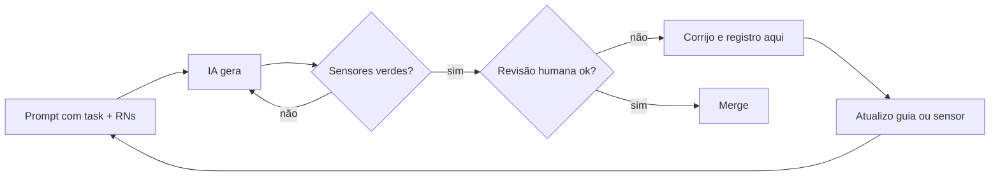

# Uso de IA — Dr. Laudo

**Referências:** [enunciado original](../teste-agendamento-exames-laudos.pdf), §§2 e 5 (uso de IA e tempo dedicado) · [PRD — requisitos e regras de negócio](PRD.md) · [RULES — regras de implementação](RULES.md).

Ferramentas: **Claude Code** (implementação e revisão), **Codex** (tarefas paralelas), chat (planejamento e documentação).
Como o uso é controlado: ver `HARNESS.md`.

## Princípios

1. A IA escreve; eu entendo, reviso e testo. Nada entra sem que eu saiba explicar.
2. Teste primeiro: o teste define o comportamento, a IA implementa.
3. Erro recorrente vira guia (AGENTS/RULES) ou sensor (lint/teste), não só correção pontual.
4. Os 5 cenários obrigatórios foram escritos e revisados por mim.

## Loop de condução

## Registro

Modelo de entrada:

> **#NN — título** · data · ferramenta · task
> **Pedido:** ...
> **O que a IA fez:** ...
> **Problema:** ...
> **Correção:** ...
> **Virou:** (regra/teste/lint) ...

---

**#01 — Conflito de horário com SELECT antes do INSERT** · planejamento · chat · T-08
**Pedido:** estratégia para impedir dois agendamentos no mesmo horário.
**O que a IA fez:** sugeriu consultar se existia agendamento no horário e só então inserir.
**Problema:** duas requisições simultâneas passam juntas pela consulta e as duas inserem (race condition).
**Correção:** índice único parcial `ON "Appointment"("startsAt") WHERE status = 'SCHEDULED'`; `P2002` → 409.
**Virou:** invariante 1 do `AGENTS.md` + cenário 1 com `Promise.all` real + D-04.

**#02 — `updateMany` condicional contra cancelar × publicar** · planejamento · chat · T-10/T-11
**Pedido:** evitar agendamento cancelado com laudo publicado.
**O que a IA fez:** propôs `updateMany` com condição de status em cada operação, como se isso impedisse a corrida.
**Problema:** erro da IA: as operações alteram tabelas diferentes; no READ COMMITTED as duas podem passar juntas (write skew).
**Correção:** `$transaction` + `SELECT ... FOR UPDATE` na linha do agendamento nas duas operações.
**Virou:** invariante 2 + teste de corrida repetido 20× + D-05.

**#03 — E-mails demo em domínio real** · planejamento · chat · seed
**O que a IA fez:** usou `@demo.com`.
**Problema:** é um domínio real; um e-mail poderia ser entregue a terceiros.
**Correção:** `@drlaudo.test` (RFC 2606/6761).
**Virou:** D-19.

<!-- Continue durante o desenvolvimento. Registre principalmente o que deu errado. -->

## Tempo dedicado ao exercício

O §5 do [enunciado original](../teste-agendamento-exames-laudos.pdf) exige informar o tempo aproximado dedicado. O prazo de três dias não equivale a horas efetivamente trabalhadas.

**Situação atual:** o tempo acumulado ainda não foi informado. Antes da entrega, registrar aqui o tempo aproximado efetivamente dedicado, distinguindo preparação documental, implementação, testes e revisão. Essa exigência faz parte do aceite de T-22 em [TASKS](TASKS.md).

## O que eu não delego à IA

Definição das regras de negócio, os 5 cenários de teste, decisões de segurança/autorização, revisão final do diff e a decisão de merge.
