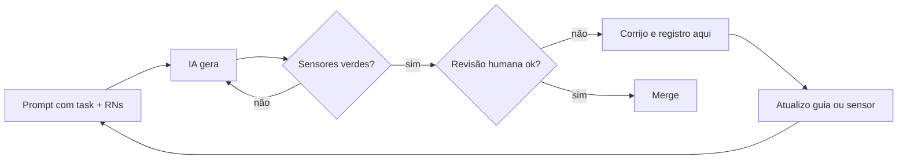

# Uso de IA — Dr. Laudo

**Autoridade:** [enunciado](DESAFIO.md), §§2 e 5 → [PRD](PRD.md). Regras compartilhadas: [AGENTS](../AGENTS.md).

O histórico inicial veio do chat de planejamento/documentação da Zaíra. OMP/Kisha coordenou especificação, implementação e revisão com especialistas. Cada registro abaixo informa sua fase e a evidência obtida naquela ocasião; resultados antigos não comprovam o estado atual. Sessões, logs e roteiros pessoais não são material de entrega.

## Princípios

1. A IA escreve; eu entendo, reviso e testo. Nada entra sem que eu saiba explicar.
2. Teste primeiro: o teste define o comportamento, a IA implementa.
3. Erro recorrente vira guia (AGENTS/RULES) ou sensor (lint/teste), não só correção pontual.
4. Os cinco cenários vêm de DESAFIO §4.4. Testes de contrato, componentes/MSW, integração PostgreSQL e E2E têm fronteiras distintas; contagem de casos não substitui prova do comportamento.

## Loop de condução

## Registro

Modelo de entrada:

> **#NN — título** · data · ferramenta · task
> **Pedido:** ...
> **O que a IA fez:** ...
> **Problema:** ...
> **Correção:** ...
> **Virou:** (regra/teste/lint) ...

---

**#01 — Conflito de horário com SELECT antes do INSERT** · planejamento · chat · T-08
**Pedido:** estratégia para impedir dois agendamentos no mesmo horário.
**O que a IA fez:** sugeriu consultar se existia agendamento no horário e só então inserir.
**Problema:** duas requisições simultâneas passam juntas pela consulta e as duas inserem (race condition).
**Correção:** índice único parcial `ON "Appointment"("startsAt") WHERE status = 'SCHEDULED'`; `P2002` → 409.
**Virou:** invariante 1 do `AGENTS.md` + cenário 1 com `Promise.all` real + D-04.

**#02 — `updateMany` condicional contra cancelar × publicar** · planejamento · chat · T-10/T-11
**Pedido:** evitar agendamento cancelado com laudo publicado.
**O que aconteceu:** a IA propôs `updateMany` com condição de status em cada operação, como se isso impedisse a corrida. A usuária aceitou inicialmente essa abordagem; a revisão posterior identificou o erro técnico da proposta da IA.
**Problema:** erro da IA: as operações alteram tabelas diferentes; no READ COMMITTED as duas podem passar juntas (write skew).
**Correção:** `$transaction` + `SELECT ... FOR UPDATE` na linha do agendamento nas duas operações.
**Virou:** invariante 2 + plano de teste de corrida repetido 20× + D-05. O plano e a aceitação inicial não são prova de execução; o resultado da suíte correspondente deve ser conferido separadamente.

**#03 — E-mails demo em domínio real** · planejamento · chat · seed
**O que a IA fez:** usou `@demo.com`.
**Problema:** é um domínio real; um e-mail poderia ser entregue a terceiros.
**Correção:** `@drlaudo.test` (RFC 2606/6761).
**Virou:** D-19.

**#04 — Frontend first sem confundir mock com backend** · 2026-11-08 · OMP/Kisha · Fase 0
**Pedido:** validar UI antes do backend, com contrato Zod compartilhado, MSW e gate visual.
**O que a IA fez:** registrou D-21, F-01…F-10 e fases B/C, transcreveu o enunciado e pesquisou versões em fontes oficiais.
**Problema:** esquema/tipo compartilhado não garante paridade runtime; MSW não demonstra segurança nem concorrência reais. O worker estático também pode entrar no build mesmo sem ativação.
**Correção:** validação nas fronteiras, isolamento dev-only, checagem de bundle/worker e provas reais na Fase B; sem código da aplicação antes do OK da Fase 0.
**Virou:** D-21 e regras de contrato/gate no [AGENTS](../AGENTS.md). Nada disso significa implementação iniciada.

**#05 — Preparar regras não autoriza começar o projeto** · 2026-11-08 · OMP/Kisha · organização
**Pedido:** manter o repositório limpo para o avaliador, sem iniciar aplicação.
**Problema:** a IA ampliou a preparação para um relatório extenso de Fase 0 e orientação para iniciar F-01.
**Correção:** encerrar esse avanço, remover relatórios redundantes e separar guias locais da documentação pública.
**Virou:** política de higiene no AGENTS e `.gitignore`; sem código, instalação ou nova publicação.

**#06 — Especificação ponta a ponta com contrato e aceite rastreáveis** · 2026-11-08 · OMP/Kisha, Felipe, Bruno e Tina · especificação
**Pedido:** completar as specs e o plano, pesquisar skills úteis e preservar o repositório limpo, sem começar a aplicação.
**O que a IA fez:** executou `npx.cmd --yes skills@1.7.6 find "specification"` e consultou a referência oficial [create-specification](https://skills.sh/github/awesome-copilot/create-specification), sem instalar a skill. Usou skills canônicas de brainstorming, planejamento, arquitetura e testes para especificar produto/UI, contrato, dados, transações, matriz de aceites e plano interno de execução.
**Problemas encontrados:** editor sem recuperação independente por URL/F5; DTOs abreviados; ausência de critérios individuais para todas as RF/RN; risco de cache entre contas e de seed sobrescrever dados modificados.
**Correção especificada:** leitura STAFF por id, mantendo o 404 de laudo ausente; schemas/erros fechados; oito RF e 25 RN rastreáveis; reset de sessão/cache e seed estável. Provas simuladas de UI continuam separadas das futuras provas reais em Postgres.
**Virou:** PRD/API/arquitetura/decisões/aceites consolidados e plano local ignorado. Checks documentais não são testes de aplicação; revisão da Zaíra e autorização de execução continuam necessárias. Sem código da aplicação, commit ou push nesta rodada.
**Verificação documental:** 33 RF/RN rastreáveis, 16 rotas e 13 códigos de erro; 72 links locais públicos, 13 âncoras e 25 exemplos JSON sem falhas. Conferidos 64 casos de ignore e a separação de dez Markdown públicos/sete guias locais. Nenhum teste de aplicação foi executado.

**#07 — Revisão enxuta com TLC Spec-Driven** · 2026-11-08 · OMP/Kisha e especialistas · especificação
**Pedido:** usar `tlc-spec-driven` para melhorar as specs após a crítica ao excesso de texto.
**Procedência:** CLI `@tech-leads-club/agent-skills` 1.6.3 (MIT); skill 4.1.0 de **Tech Leads Club / Felipe Rodrigues**, sob [CC-BY-4.0](https://creativecommons.org/licenses/by/4.0/), conforme a [fonte oficial](https://github.com/tech-leads-club/agent-skills/tree/main/packages/skills-catalog/skills/%28development%29/tlc-spec-driven). Conteúdo adaptado às regras nativas e ao projeto.
**Instalação:** mecanismo oficial, somente destino local `claude-code`, sem configuração global, força ou symlink. CLI executado com Node 24 temporário no cache, separado do runtime planejado da aplicação. Skill e lockfile são estado local ignorado; o arquivo principal instalado foi conferido pelo hash da fonte upstream.
**Método:** Specify em `docs/PRD.md`, aceito como caminho pelo validador oficial, sem duplicá-lo em `.specs`. EARS define os aceites; API descreve o wire; arquitetura descreve o mecanismo; TESTING define as provas. O roteiro existente não equivale a um novo Tasks TLC aprovado.
**Limites:** aprovação humana da spec precede novo Design/Tasks; nenhuma aprovação fictícia, execução de aplicação ou commit automático. Testes primeiro e demais regras do projeto prevalecem sobre defaults da skill.
**Revisão:** Felipe condensou produto/desenho/roteiro; Bruno, o contrato; Tina, a estratégia de provas. A integração corrigiu uma restrição indevida de tamanho na lista de exames, preservou o contrato literal de testabilidade da UI e distinguiu reconciliação de agendamento/laudo do tratamento de falha no login.
**Verificação documental:** `py -3 .claude/skills/tlc-spec-driven/scripts/validate_spec.py docs/PRD.md --strict` → zero erros e zero avisos. Conferidos 33 RF/RN no PRD e na matriz de QA, 32 IDs F/T no crosswalk, 16 rotas, 45 schemas, 13 ErrorCode e dez ValidationRule; mensagens/status preservados. Links locais: 69 públicos e 27 internos, 11 âncoras, dois blocos JSON e 49 tabelas sem falhas. Os 47 casos de ignore passaram; dez Markdown públicos e sete guias locais não rastreados. Nenhum arquivo de aplicação, commit ou push criado nesta rodada.

**#08 — Aprovação do Specify e preparação de Design/Tasks** · 2026-11-08 · OMP/Kisha · planejamento
**Autorização recebida:** “pode seguir”, em resposta ao pedido de aprovação do PRD para avançar ao desenho e plano. Registrada no PRD com as palavras da usuária; não aprova Tasks, código, instalação de dependências do produto, commit ou publicação.
**Limite identificado na ferramenta:** `validate_tasks.py` aceita nosso caminho de plano, mas `unapproved()` procura os nomes fixos `spec.md`/`tasks.md` e ignora ausentes. Por isso `--execute` isolado não comprova aprovação do PRD canônico. O projeto exige conferir explicitamente `docs/PRD.md` e `docs/TASKS.md`, sem cópia de documentos ou alteração da skill para simular aprovação.
**Desenho:** Bruno consolidou componentes, interfaces, dependências, modelo, transações, reversão, reuso documental e riscos, sem reabrir stack ou escopo. Design permanece em revisão.
**Correção na revisão:** o desenho colocava construção do DTO após commit. Foi ajustado para selecionar/mapear/validar a saída da mutação dentro da transação e responder depois do commit, sem nova consulta. Assim falha de validação ainda pode reverter; falha de transporte pós-commit continua exigindo reconciliação. Nenhum desses caminhos foi executado.
**Automação ainda não homologada:** os validadores de pré-aprovação aceitam caminhos de arquivo; `check_proofs.py` recebe feature e usa a estrutura `.specs/features`, não `docs/TASKS.md` como arquivo. Esta rodada não cria cópias/relatórios para simular compatibilidade nem declara o Execute automático pronto; os comandos e registros reais devem ser conferidos no harness antes da futura execução autorizada.
**Plano:** Felipe detalhou entregas de A/B/C, dependências, responsáveis propostos, testes junto do comportamento e seletores futuros por aceite. A revisão retirou fragmentação mecânica, explicitou primeiros produtores dos componentes reutilizados e manteve os 32 IDs históricos sem duplicar execução. Docker/deploy permanecem opcionais.
**Testabilidade:** fixtures B podem preparar estados explícitos em Postgres real apenas no Arrange; a ação sob teste continua HTTP real, com observação pós-commit. Isso permite testar cancelamento com DRAFT/PUBLISHED sem depender de endpoints futuros nem adiar seus guardas. E2E continua criando negócios pela API real; preparação direta não prova o produtor do estado.
**Gate de Tasks:** primeira execução encontrou 28 divergências por definições sem associação explícita à fase; corrigidos os agrupamentos de headings, sem modificar a skill ou apagar dependências. A execução seguinte retornou zero erros e três avisos `Tests: none` em CI/empacotamento/operação. Conferidos contra a matriz: exigem Build/suítes existentes/smoke/observação, não testes artificiais de configuração.
**Verificação final:** Specify em modo strict sem erros/avisos; 42 entregas planejadas e 87 critérios mapeados individualmente, preservando os aceites aprovados, 33 RF/RN e 32 IDs legados. Contrato HTTP inalterado: 16 rotas, 45 schemas e 13 códigos de erro. Conferidos 69 links públicos, 25 internos, 11 âncoras, dois JSON, 53 tabelas e 47 casos de ignore sem falhas; dez Markdown públicos/sete guias locais. Sem arquivos de aplicação, testes de produto, commit ou push. Revisão/aprovação do plano e autorização de implementação continuam pendentes.

**#09 — Commit da base documental e higiene da entrega** · 2026-11-08 · OMP/Kisha · versionamento
**Autorização:** “pode commitar a base do projeto sim”. Escopo: commit local da documentação e regras de ignore; não autoriza implementação, instalação de dependências do produto, push ou publicação.
**Preparação:** seleção explícita dos arquivos públicos, sem `git add .`; guias, adaptadores, skills e estado de ferramentas permanecem locais e fora do índice. `.specs` também é ignorado como artefato interno, sem excluir PRD, contrato, código, testes, migrations, assets ou lockfile.
**Alteração separada:** a exclusão local pré-existente do PDF original não integra este commit e não foi revertida; o original já versionado e a transcrição do enunciado permanecem preservados.

**#10 — Início autorizado do frontend pelo contrato compartilhado** · 2026-11-08 · OMP/Kisha, Marquinho e Marcelo · T1
**Autorização:** “pode começar então a implementação do plano”, frontend antes do backend; modo escolhido: “Especialistas coordenados”. Escopo desta unidade: primitivas/identidade e tooling do contrato, sem criar web vazia, backend, banco ou infraestrutura; sem commit/push.
**Método:** TLC e Superpowers aplicados às ferramentas/regras nativas, com ownership separado e teste primeiro. Kisha escreveu os testes e executou RED antes dos especialistas completarem o código: 137 casos, 83 falhas comportamentais/54 verdes; runner/imports funcionaram. Um caso adicional de limite Unicode falhou separadamente, elevando o total a 138.
**Correções preventivas:** npm avisou que ESLint 9 não tinha mais suporte; adotar ESLint 10 com Node >=22.13. TypeScript 7 está fora do peer do parser (<6.1), então fixar 5.9.3. A documentação oficial e um probe real mostraram que Zod 4.6 passou a contar pontos de código em min/max/length; preservar `String.length`/UTF-16 exigido pela API em refinamentos explícitos, sem mudar o requisito.
**Limite da prova:** parsers de claims/token não validam assinatura, propriedade, senha nem autorização. Os cinco cenários finais continuam exigindo API/Postgres reais na Fase B.
**Verificação:** `npm ci` seguido de build/typecheck/lint/check:arch/test passou; 138/138 casos em dois arquivos, Vitest Node com TZ Asia/Tokyo. Arquitetura: seis módulos/13 dependências, sem violações. Smoke real via `import '@drlaudo/contract'` consumiu ESM emitido e validou normalização/DTO strict/calendário/Date10000/claims. Probe em memória confirmou rejeição de `any` e hex em JSX. Corrigidas opções de tooling incompatíveis (`allowOnly: false` no Vitest; remover `extensionAlias` não exposto pelo dependency-cruiser) e representação de número inseguro no teste, sem alterar a asserção.
**Revisão:** revisor independente não encontrou defeitos na implementação. Tina identificou lacunas de cobertura de claims ausentes, e-mail no limite com espaços e dia32; adicionados nove casos. Mutações temporárias reproduziram sete falhas esperadas e foram removidas; o código correto voltou a passar build/typecheck/lint/check:arch e **147/147 testes**, sem enfraquecer asserções. O parecer do revisor usa a execução informada pela coordenação, não é uma segunda execução independente.

**#11 — Implementação completa da Fase A (Frontend e Contrato)** · 2026-11-08 · OMP/Kisha, Marquinho, Marcelo, Marta e Mario · T2 a T20
**Autorização recebida:** “faça todo o frontend e me de o amibeinte local pra aparovar” e “outro ponto é pra ir commietando por ft, é ta alinhado isso?”. Escopo executado: todo o frontend (Fase A) com contrato compartilhado, mock MSW 3.x, store Redux/RTK Query, layout responsivo, jornadas da equipe, portal do paciente, catálogo de design system e testes comportamentais. Sem backend real, banco ou push.
**Decisão de produto sobre calendário e IANA (D-42):** identificada contradição histórica na data 03/10/1931 (avanço de 11:00 para 12:00 pelo Decreto 21.896 gerando 22 slots civis reais em vez de 24). A usuária escolheu “Somente horários existentes”, preservando o calendário 0001–9999 e o IANA exato.
**Trabalho especializado:**
- Marquinho: contrato completo (45 schemas/tipos, 13 ErrorCodes, 10 ValidationRules, 9 constantes, 5 funções temporais puras);
- Marta: design system, tokens OKLCH, primitivas Radix/shadcn, componentes de produto (`StatusBadge`, `SlotGrid`, `ReportViewer`, etc.);
- Mario: servidor MSW 3.x cobrindo as 16 rotas REST com validação estrita, precedência normativa, banco em memória isolado por aba (`sessionStorage`) e controles injetáveis;
- Marcelo: Redux store, RTK Query único com 15 hooks, isolamento de sessão com geração para abortar respostas tardias e proteção de rotas;
- Kisha: coordenação, páginas da equipe e paciente, integração de rotas, verificação ponta a ponta e auditoria visual no Chromium.
**Verificação técnica:** 809 testes passaram (490 de contrato e 319 da web); build de produção gerado com sucesso sem empacotar o worker de mock; typecheck estrito com zero erros; lint com zero erros/warnings; dependency-cruiser com zero violações. Servidor Vite iniciado na porta 5173 e auditado com capturas de tela reais de todas as jornadas.

**#12 — Redesign clínico premium solicitado pela usuária** · 2026-11-08 · OMP/Kisha, Marquinho e Marta
**Pedido:** usar skills como Impeccable e melhorar todo o layout. A usuária respondeu “continue” à proposta de direção clínica sóbria contemporânea, preservando logo, azul/teal e funcionalidades.
**Skills consultadas:** Impeccable 4.5.1 (redesign/Operate/craft-floor) e hierarquia visual tipográfica. O launcher `impeccable context` falhou por ausência do binário; não foi instalado executável nem alegada auditoria automática. A skill anti-layout-genérico encontrada para landing pages estáticas não foi imposta à aplicação.
**Mudança:** Marquinho refez shell/login; Marta recompôs agenda, agendamento e portal; Kisha integrou tokens, primitivas, editor/leitor e catálogo. Nenhuma dependência nova ou alteração do contrato HTTP.
**Problema encontrado:** o teste do shell ultrapassou a espera padrão enquanto a rota lazy carregava. A asserção passou a aguardar o título específico “Meus exames”, com tolerância de 5 s, mantendo todas as verificações. A investigação também expôs `SessionGate` como fallback de página, repetindo `main`/rodapé dentro do shell; substituído por estado de carregamento local, sem nova autenticação.
**Smoke observado:** Chromium em 1440 e 375 px; login, agenda vazia/com dados, criação de agendamento fictício, edição/salvamento/publicação com confirmação e teclado, leitor publicado, portal sem texto de rascunho e estado opaco ao abrir rascunho. Sem overflow horizontal nas telas medidas ou erros no console. Documentação visual atualizada; aprovação final visual continua com a usuária.
**Gates após a correção:** cenário de autenticação 36/36, suíte completa 490 contrato + 319 web = 809/809; lint, typecheck, build e check:arch passaram. Build mantém aviso de chunk principal acima de 500 kB (599,92 kB minificado), sem ocultar nem alterar o limite. Sem nova certificação de contraste/AA.

**#13 — Continuidade dos fluxos sem novos módulos** · 2026-11-08 · OMP/Kisha, Marquinho e Marta
**Pedido:** “melhore todos esses pontos que vc abordou, por favor”, cobrindo os cinco aprimoramentos propostos e a correção do h1 duplicado. Sem IA no produto, dependência nova ou mudança HTTP.
**Implementação:** Marquinho: feedback/destaque/foco pós-criação, abertura do registro e agenda com data extensa/paciente preservado. Marta: contadores após trim/UTF-16, estado salvo/dirty, revisão literal da versão salva com rolagem e headings STAFF. Kisha: agrupamento mensal por Brasília, helpers temporais, testes iniciais, integração, smoke e documentação.
**Falhas/prevenção:** seis regressões falharam antes da implementação, 40 casos continuaram passando. A revisão do editor corrigiu um risco real: falha capturada pelo pai resolvia Promise<void> e o filho tratava como sucesso; agora há resultado boolean explícito e preservação do texto bruto/dirty. Duas asserções novas aguardavam texto cru da API, embora a UI o mapeie: removido esse acoplamento e aguardado o alerta, preservando verificações de conteúdo/dirty/reconciliação.
**Provas:** 66/66 nos cinco arquivos afetados; suíte completa830/830, lint/typecheck/build/check:arch verdes. Chromium1440/375: agendar→localizar→abrir; anterior/próximo/Hoje preservam paciente; foco no registro visível e ausência de sucesso inventado por query. Editor→salvar→reeditar remove aviso antigo; revisão mostra título/profissional/texto salvo; 10.000 caracteres e marcação HTML literal sem interpretação, rolagem interna e botões alcançáveis/teclado. Publicado e cancelado com um h1; portal mensal sem rascunhos. Probe Node em Asia/Tokyo confirmou bordas de mês/anos e DST. Aviso bundle599,93kB permanece. Sem teste de backend real, nova certificação AA, aceite visual, commit ou push.

**#14 — Usabilidade de rotas, atrito de edição e medição WebAIM** · 2026-11-08 · OMP/Kisha, Marquinho e Marta
**Pedido:** “blz faça essas melhorias agora, por favor”, cobrindo retorno contextual do laudo, barra inferior de ações do editor com estado, cabeçalho mobile compacto (<=112px), terminologia “Data do exame” e verificação de acessibilidade/contraste.
**Implementação:** Marquinho implementou o retorno contextual em `ReportPage` e `AgendaPage` com sanitização estrita de `date` e `patientId`. Marta construiu a barra inferior do `ReportEditor` com medição defensiva de viewport e fallback para fluxo estático sob zoom 200%, além do cabeçalho compacto de 111 px no `AppShell`. Kisha implementou a rotulagem “Data do exame” no `ReportViewer`, corrigiu o contraste da borda de inputs no CSS e conduziu a medição no WebAIM e testes no navegador.
**Problemas encontrados e corrigidos:**
1. `TypeError: heading.scrollIntoView is not a function`: `RouteFocus` invocava `scrollIntoView` incondicionalmente, falhando em ambientes jsdom onde o método não é mockado por padrão; adicionada guarda defensiva de tipo.
2. Falha de parse de `ErrorResponse`: teste de erro 404 em `reports.test.tsx` fornecia mensagem arbitrária violando o contrato estrito `ErrorResponseSchema` (que exige `'Não encontramos este registro'` literal para `NOT_FOUND`); corrigida fixture do teste para o contrato canônico.
3. Contraste insuficiente medido: a medição via API do WebAIM Contrast Checker detectou que a borda dos inputs (`#bec9d3`) apresentava razão de apenas 1.68:1 sobre branco. O token `--input` foi ajustado para `oklch(0.64 0.018 245)` (`#838e97`), alcançando 3.34:1 e superando o mínimo de 3:1 exigido para componentes de interface.
**Evidências observadas:** 865 testes passando (490 contrato + 375 web). No Chromium: retorno contextual restaura data e paciente após visualização de laudo; barra do editor ancorada exibe status sem cobrir campos; cabeçalho móvel ocupa 111 px com alvos de 44 px; zoom de 200% sem scroll horizontal; "Data do exame" exibido sem "Realizado em". Aviso de bundle minificado acima de 500 kB (600,20 kB) permanece transparente. Teste com leitor de tela nativo físico não pôde ser executado por ausência de resposta ao pedido de controle do computador.
**#15 — Backend real, banco e entrega executável** · 2026-11-08 · OMP/Kisha
**Pedido:** “implemente tudo agora negao”, cobrindo a Fase B e o empacotamento.
**Implementação:** `apps/api` com Fastify 5 + Prisma 7 + `@prisma/adapter-pg` sobre PostgreSQL 16, schemas Zod reutilizados de `packages/contract`, `buildApp` sem `listen` para `app.inject()`, relógio injetável, `DomainError` com envelope canônico, autenticação em `onRequest` com reconferência de identidade no banco, rate limit por IP no login e logging pino com `Authorization` redigido. Migration manual com índice único parcial e checks; seed idempotente por UUID com datas relativas somente no primeiro create. `docker-compose.yml` (demo em `:8080`), `docker-compose.qa.yml` (QA com `tmpfs`, sem portas), Dockerfiles e Nginx com proxy `/api` e CSP.
**Falhas encontradas e corrigidas:**
1. `Fastify` era importado como valor nomeado; a sobrecarga caía em HTTP/2. Corrigido para `import Fastify from 'fastify'`.
2. `trustProxy` não aceita número no tipo do Fastify; o hop counting do desenho virou booleano documentado.
3. `allowedAlgorithms` não existe em `@fastify/jwt`; o correto é `algorithms` (`fast-jwt`).
4. `P2002` do adapter aninhado não traz `meta.target`; a classificação passou a ler `meta.driverAdapterError.cause.constraint.index`, com fallbacks, senão o conflito de slot virava `500`.
5. `@fastify/rate-limit` com `global: false` só limita rotas com `config.rateLimit` objeto; `true` lança erro na inicialização.
6. Testes de contrato acessavam `response.json().details` em vez de `.error.details`; o envelope é `{error:{...}}`.
7. Query duplicada acumulava `DUPLICATE_QUERY` e `INVALID_TYPE` para a mesma chave; a regra de duplicidade agora suprime as demais regras daquela chave.
8. `npm test` em workspaces paralelos fazia a integração Postgres competir com o jsdom e derrubar uma espera de UI por tempo; a raiz passou a encadear contrato → API → web.
**Provas observadas:** 490 contrato + 41 integração + 375 web = 906 verdes; lint/typecheck/build/check:arch limpos. Integração: agendamento concorrente com uma linha persistida, `422 PAST_DATE`, quatro `404` idênticos para alheio/inexistente/sem laudo/rascunho, publicação imutável, corrida cancelar × publicar cinco vezes com um vencedor. Smoke manual em Chromium contra a API real: login, agenda do seed, criação com destaque, salvamento, publicação, portal e 404 opaco. Pendentes: leitor de tela nativo, celular físico, deploy publicado.
**#16 — Validação do QA em Compose** · 2026-11-08 · OMP/Kisha
**Pedido:** responder o que falta e fechar lacunas verificáveis.
**Achados:** rodar `docker compose -p drlaudo-qa -f docker-compose.qa.yml run --rm api-test` falhou duas vezes. Primeiro, o transform do Vitest resolvia `../../tsconfig.base.json` e a imagem de runtime não copiava o arquivo; passou a copiá-lo. Depois, a guarda de banco recusava `DATABASE_URL` igual a `DATABASE_URL_TEST`, o que é legítimo no contêiner de QA, cujo único banco é descartável; a guarda agora só recusa igualdade quando a URL principal não aponta para `drlaudo_test`.
**Resultado:** 41/41 testes de integração dentro do Compose de QA, com banco em `tmpfs` e sem portas públicas. A suíte local foi reexecutada depois do ajuste.

**#17 — Auditoria e correção integral da entrega** · 2026-11-09 · OMP/Kisha, Mario, Marquinho, Tina, Marcelo e Marta
**Autorização:** “corrija tudo e deixe pronto para entrega”, após a auditoria ter revogado a conclusão prematura de que faltavam apenas ajustes finais. Inclui o cadastro/gestão administrativa de pacientes já decidido para o produto; não autoriza push ou deploy.
**Falhas reproduzidas na auditoria:** a guarda de QA aceitava uma substring na query como se fosse o nome do banco; o setup podia então executar `DROP SCHEMA` no alvo incorreto. Alterar X-Forwarded-For contornava o limite de login. Headers Nginx estavam ausentes no HTML. Instalação limpa falhava no typecheck por contrato não compilado. O retorno ao login perdia data/paciente. A suíte web completa teve um timeout, embora o caso isolado passasse.
**Lacunas encontradas:** publicação e leitura do paciente eram testadas separadamente com fixture já publicada; a verificação de JWT usava relógio real contra emissão QA fixa; faltavam provas de locks/corridas/seed, E2E e algumas reconciliações de UI. DTOs inválidos podiam causar 500 depois de a escrita já ter sido confirmada.
**RED observado antes das correções:** três regressões em PostgreSQL descartável confirmaram cancelamento, edição e publicação persistidos apesar da resposta 500. Testes puros confirmaram falhas de validação de DTO e de URLs QA; nenhuma prova da guarda conectou a bancos de demonstração ou produção. Os resultados GREEN e de entrega são registrados somente depois dos gates finais.

<!-- Continue durante o desenvolvimento. Registre principalmente o que deu errado. -->

**#18 — Revisão final independente e dois defeitos de produção** · 2026-11-09 · OMP/Kisha
**Pedido:** “reveja” a entrega antes de aprovar.
**Verificado de novo:** lint, typecheck, check:arch, 514 contrato + 309 API + 424 web + 38 E2E, build, `docker compose up --build` com seed idempotente em restart, CSP/noindex/404 JSON/401 genérico, rate limit real (10 → 429 com `Retry-After`, X-Forwarded-For forjado não desvia), jornadas staff e paciente em 375 px.
**Defeito 1 — cancelamento e conclusão anterior revista.** Durante a revisão anterior, 25 abortos no navegador produziram 13 logs de erro; após a guarda então aplicada, 25 abortos produziram zero logs de erro e 15 registros de cancelamento. Essa observação não identificou a causa específica no driver nem comprovou a segurança da guarda. A revisão seguinte demonstrou que `request.raw.destroyed` também é verdadeiro após leitura normal: erros legítimos em GET e POST com socket aberto ficaram sem resposta. O teste anterior cobria somente desconexão, não esse caso.
**Defeito 2 — fonte inline bloqueada por CSP.** O CSS de produção embutia uma variante do Plus Jakarta Sans como `data:font/woff2`; `font-src 'self'` bloqueava o pedido. `assetsInlineLimit` passou a não embutir WOFF/WOFF2: 11 fontes viraram arquivo, `data:font` no CSS caiu a zero e o console ficou sem falhas de rede. Correção factual: o arquivo pequeno emitido é o subset cyrillic-ext, não o vietnamita identificado anteriormente.
**Observação não alterada:** a barra lateral repete “Equipe Dr. Laudo” no nome e no perfil (seed + rótulo em `AppShell.tsx`), decisão de microcopy do Gate A.

**#19 — Correção após revisão final** · 2026-11-09 · OMP/Kisha, Tina e Mario
**Pedido:** “faça todos os ajustes estão e deixe tudo 100% pronto”. Aprovação visual, push, publicação e envio continuam decisões separadas.
**RED:** em sockets HTTP reais, falhas inesperadas com cliente conectado em GET e POST ficaram sem resposta; três casos de corpo proibido, inclusive chunked aberto, terminaram em `socket hang up` em vez de 400.
**Correção:** a guarda passou a inspecionar a conexão/resposta em vez do estado de leitura da requisição. Para `NoBody`, o iterador não destrói o socket ao encontrar o primeiro byte; a resposta 400 é entregue e a conexão encerrada, sem drenar um corpo infinito. Os testes reais dos dois caminhos e o teste de sanitização de logs passaram isoladamente antes dos gates completos.
**Proxy e entrega:** a primeira prova com Nginx deixou um GET chunked aberto sem resposta: o buffer padrão esperava o fim do upload antes de encaminhá-lo. `check:delivery` reproduziu o timeout; com `proxy_request_buffering off`, o mesmo teste passou para corpo finito e upload aberto. Em QA Docker separado, também passaram headers/cache/redirect e limite de login com IP forjado. Na demo local, Chromium mostrou agenda e portal/laudo publicado com dados fictícios; a 375 px o portal não teve scroll horizontal nem indicou rascunho.
**Gates observados:** em cópia limpa das fontes candidatas, `npm ci`, lint, typecheck, check:arch, build, `npm test` e `npm run test:e2e` passaram: 514 testes de contrato, 314 de API/unidade, 424 web e 38 E2E. Após a mudança no script de entrega, lint voltou a passar. O build avisou sobre chunk acima de 500 kB; a suíte emitiu aviso de depreciação do `pg`.

**#20 — Publicação da demo e conciliação documental** · 2026-11-09 · OMP/Kisha
**Pedidos:** organizar commits por funcionalidade; integrar na main e disponibilizar ambiente local; sincronizar GitHub; implantar na VPS com subdomínio de zairagoncalves.com usando os acessos do LifeOS; “por favor deixe tudo completo pra eu enviar o projeto”.
**Execução anterior observada:** commits por funcionalidade, merge fast-forward, push, implantação Compose e regra DNS/Tunnel. README recebeu a URL pública. Health HTTPS e login STAFF foram conferidos; o aguardo de URL expirou, mas a inspeção seguinte confirmou agenda carregada e console sem erros. Não apresentar o timeout do helper como falha de autenticação.
**Conciliação:** README, arquitetura, decisões, PRD e plano local passaram a distinguir entrega implementada, implantação pública, provas históricas e pendências humanas. TESTING foi atualizado para 14 códigos de erro e configuração E2E efetivamente entregue.
**Verificação desta revisão:** `BASE_URL=https://drlaudo.zairagoncalves.com npm run test:e2e:smoke` passou **3/3** (health/PostgreSQL, login/leitura STAFF e PATIENT), sem mutações de negócio. A suíte integral anterior de 1.290 testes não foi reexecutada por alteração apenas documental. Consulta ao GitHub confirmou repositório privado; envio depende de acesso do avaliador ou ZIP. CI remoto bem-sucedido não foi comprovado. Aprovação visual/UX, leitor de tela nativo, celular físico, backup/restore e meta de instalação <5 min não foram presumidos.
**Gates documentais:** validador oficial `validate_spec.py docs/PRD.md --strict` retornou zero erros/avisos; inventário de 234 fontes rastreadas confirmou 69 links Markdown relativos sem destinos ausentes e nenhum caminho de `.env`, dependências instaladas, relatórios, credenciais temporárias ou builds. ZIP gerado fora do repositório com as versões atuais dos arquivos, conferindo CRC, inventário e igualdade de cada entrada com a fonte. Busca por padrões conhecidos de tokens/chaves privadas não encontrou ocorrências; isso não equivale a auditoria completa de segredos/histórico. Não houve novo commit/push nem envio ao avaliador nesta revisão.

**#21 — Repositório público autorizado** · 2026-11-09 · OMP/Kisha
**Pedido:** “pode inclusive deixa ele publico e jogar tudo no ar”, referindo-se ao repositório do projeto e à publicação das atualizações.
**Verificação e ação:** inventário atual de 234 arquivos e 325 blobs do histórico conferidos por padrões conhecidos de tokens/chaves privadas, sem ocorrências; nenhum caminho de ambiente privado encontrado no histórico. Essa busca não comprova ausência de todo tipo de segredo. `gh repo edit zaairaag/drlaudo --visibility public --accept-visibility-change-consequences` executado; consulta seguinte confirmou `PUBLIC`. README e TESTING atualizados para acesso público. Não houve envio de mensagem ao avaliador nem alteração de dados clínicos.
**Achado na publicação:** a execução remota falhou antes de criar jobs. A anotação pública confirmou `Unrecognized named-value: 'job'` nas conexões QA declaradas no `env` do job. Correção mínima: resolver a porta dinâmica no contexto de um step e exportar ambas as conexões via `GITHUB_ENV`, preservando isolamento e banco real. A confirmação do CI depende da execução remota, não do resultado local anterior.
**Resultado remoto:** [CI 42659130337](https://github.com/zaairaag/drlaudo/actions/runs/42659130337), revisão `9f11486`, concluiu com sucesso em 5m57s, incluindo instalação limpa, lint, typecheck, arquitetura, testes reais, build, Chromium/E2E/acessibilidade e prova Nginx/proxy em Docker QA descartável. Avisos não bloqueantes do runner sobre Node20 das actions e ubuntu-latest foram preservados. README público acessível sem autenticação; health da demo confirmou API e banco ok. A VPS recebeu as fontes públicas via pull fast-forward, sem alterar massa ou reiniciar serviços por mudanças documentais.

**#22 — Correção da expiração identificada no CI** · 2026-11-09 · OMP/Kisha
**Pedido:** ajustar o CI/CD a partir da execução 42684567860, job129387791280.
**Diagnóstico:** contrato514/API314 passaram; web teve 423/424, falhando no isolamento após expiração. O callback verificava o prazo uma única vez; se executado antes do instante civil de expiração, não agendava nova verificação.
**RED/GREEN:** regressão com relógio/timers controlados reproduziu um disparo antecipado em1ms: esperava anonymous e recebeu authenticated. O primeiro ensaio parou na espera de uma página lazy, corrigida na preparação sem mudar o oráculo. O callback passou a recalcular/agendar o restante e limpar o timer anterior. Arquivo auth completo passou50/50. Sem suprimir testes, alterar timeouts ou retries, nem modificar regras HTTP/JWT do backend.
**Gates locais:** lint, typecheck e check:arch passaram; suíte web425/425 em19arquivos. Verificação remota completa será vinculada à revisão corrigida, sem reaproveitar o sucesso de uma revisão anterior como prova desta mudança.

## Tempo dedicado ao exercício

O §5 do [enunciado](DESAFIO.md#5-entrega) exige informar o tempo aproximado dedicado. O prazo de três dias não equivale a horas efetivamente trabalhadas.

**Tempo aproximado informado pela autora:** **5 horas**, em 2026-11-09, ao responder à pergunta sobre o tempo dedicado até então. Estimativa da própria Zaíra, não inferida do prazo de três dias nem da soma de processos paralelos da IA.

## O que eu não delego à IA

Definição das regras de negócio, os 5 cenários de teste, decisões de segurança/autorização, revisão final do diff e a decisão de merge.
