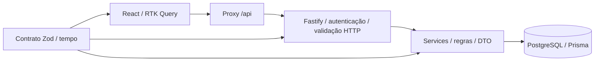

# Arquitetura — Dr. Laudo

**Autoridade:** [DESAFIO](DESAFIO.md) → [PRD](PRD.md). [API](API.md) define o contrato HTTP; [DECISIONS](DECISIONS.md), escolhas e limites; [TESTING](TESTING.md), evidências e gates. Este documento descreve o desenho da entrega; não concede aprovação visual nem comprova sozinho sua execução.

## 1. Visão geral

Monorepo npm workspaces, Node 22.22.2, TypeScript strict. React/RTK Query consome `/api` relativo; Fastify 5 executa autorização e regras sobre Prisma 7/PostgreSQL 16. `packages/contract` fornece schemas Zod runtime, tipos inferidos, erros, enums e funções puras de tempo. Não há microsserviços, filas, notificações ou processamento clínico.



MSW é uma ferramenta alternativa de desenvolvimento: somente `main.tsx`, fora de mocks, importa-o dinamicamente com `DEV && VITE_API_MOCKING === 'true'`. Não prova JWT, propriedade, transações ou concorrência. O build final não pode conter worker, handlers, controles ou catálogo de design system.

## 2. Organização e dependências

| Área | Responsabilidade |
|---|---|
| `packages/contract/src` | Superfície pública em `index.ts`, schemas/tipos HTTP, constantes e slots IANA; sem dependência das aplicações ou frameworks |
| `apps/api/src/app.ts` | `buildApp({prisma,clock,config})`, sem listen; composição HTTP para testes via `app.inject()` |
| `apps/api/src/server.ts` | Ambiente, recursos reais, listen e shutdown |
| `apps/api/src/plugins` e `lib` | Autenticação, parsing/validação, erros sanitizados e classificação de conflitos |
| `apps/api/src/features` | Routes finas HTTP, services com Prisma/clock e DTOs com selects explícitos |
| `apps/api/prisma` | Schema, migration versionada e seed demonstrativo |
| `apps/web/src/app` | Store único, transporte, sessão, geração de requests e navegação segura |
| `apps/web/src/features` | Login, agenda, agendamento, laudos, portal e administração de pacientes |
| `apps/web/src/components/ui`, `product` | Primitivas acessíveis e componentes de produto compartilhados |
| `apps/web/src/mocks` | Banco fictício, handlers HTTP e setup MSW, somente dev/testes |
| `apps/e2e` | Playwright/axe sobre frontend de produção e API/PostgreSQL reais |
| `docker`, Compose e `.github/workflows` | Execução local reproduzível, proxy, QA isolado e CI |

Contrato compila para ESM/declarations em `dist`. Consumers dependem desse artefato, portanto os scripts constroem o contrato antes de typecheck/test/build, também em instalação limpa. `check:arch` deve cobrir API/web/contrato, ciclos e fronteiras; não substituir análise de autorização ou testes.

A API usa o gerador `prisma-client` com TypeScript em `src/generated/prisma` (ignorado), `@prisma/adapter-pg`/`pg` e `prisma.config.ts`. Executa com `tsx`; seu build faz geração e typecheck, sem um segundo runtime JavaScript. Dependências de desenvolvimento na imagem são um limite de tamanho, não uma alegação de imagem mínima.

## 3. Modelo de dados

| Entidade | Campos principais e restrições |
|---|---|
| User | UUID, nome, e-mail normalizado único, hash bcrypt, role STAFF/PATIENT, createdAt |
| ExamType | UUID, código único XRAY/ULTRASOUND/MRI, nome |
| Appointment | UUID, patientId, examTypeId, startsAt timestamptz(3), SCHEDULED/CANCELED, createdAt, canceledAt |
| Report | UUID, appointmentId único, título/corpo/profissional, DRAFT/PUBLISHED, createdAt/updatedAt/publishedAt |

FKs preservam histórico e restringem exclusão. A aplicação verifica que `patientId` pertence a PATIENT. Não há reparenting, exclusão, reativação, despublicação ou mudança genérica de status por HTTP.

```sql
CREATE UNIQUE INDEX "appointment_active_slot_unique"
  ON "Appointment" ("startsAt") WHERE "status" = 'SCHEDULED';
```

Checks mantêm canceledAt consistente com status do agendamento e publishedAt consistente com status do laudo. `Report.appointmentId` é único. Checks separados **não** impedem sozinhos CANCELED + PUBLISHED; a trava comum abaixo é necessária.

## 4. Fluxo HTTP e atomicidade

Auth e perfil rodam antes do parser nas rotas protegidas. Login limita tentativas antes de parse; health é público. Entradas strict são validadas e normalizadas antes de consultar existência/estado; saída inválida é falha interna, nunca erro do cliente ou entidade crua como fallback.

Routes cuidam de HTTP. Services recebem dependências injetadas e não importam Fastify. Toda resposta usa `select` explícito e DTO runtime; nas mutações, selecionar/mapear/**validar antes do commit**. Qualquer falha nesse ponto reverte a escrita. A resposta só sai após confirmação da transação. Transporte perdido depois de commit é resultado incerto para a UI, não rollback possível.

Erros e precedências pertencem à API. Apenas P2002 de restrição conhecida vira conflito: slot ativo → SLOT_TAKEN, appointmentId único → REPORT_EXISTS, e-mail único → EMAIL_TAKEN. Outros erros são 500 sanitizados.

Quando uma rota sem corpo recebe conteúdo, a API responde 400 após o primeiro byte e pode fechar a conexão depois da resposta, sem drenar uma transmissão infinita. Uma falha inesperada só é tratada como desconexão quando o socket ou a resposta já estão destruídos; o estado de leitura do `IncomingMessage` não identifica, por si só, uma desconexão.

## 5. Concorrência

| Operação | Garantia |
|---|---|
| Criar agendamento | INSERT e índice parcial arbitram o slot; não SELECT prévio como proteção |
| Cancelar | Transação, FOR UPDATE Appointment, releitura SCHEDULED/ausência de PUBLISHED; canceledAt pelo clock; preservar DRAFT |
| Criar laudo | Mesma trava/releitura; SCHEDULED e ausência de laudo antes de inserir DRAFT |
| Editar/publicar | Resolver vínculo sem decidir estado, travar Appointment primeiro, reler ambos na mesma transação, validar e escrever |

SQL parametrizado na mesma conexão: `SELECT id FROM "Appointment" WHERE id = $1::uuid FOR UPDATE`. Dentro do callback usar apenas client transacional. Ordem única Appointment primeiro; READ COMMITTED basta. Sem chamada externa, fila, retry automático ou SERIALIZABLE.

Cancelar vence publicação → CANCELED/DRAFT; publicar vence cancelamento → SCHEDULED/PUBLISHED. Editar antes pode ser incorporado na publicação; editar depois falha. Criar antes de cancelar preserva DRAFT bloqueado; cancelar antes impede a criação. Um now é capturado após lock/releitura para os timestamps da operação. Saves DRAFT têm última escrita por campo enviado, sem versionamento otimista.

## 6. Autenticação, autorização e administração

JWT HS256, issuer/claims exatos e 8h; emissão e verificação recebem o mesmo Clock. bcrypt custo 10; login errado e conta inexistente têm resposta genérica e comparação de hash com mesmo custo. Perfil e usuário persistido são reconferidos. Assinatura e autorização pertencem exclusivamente ao backend.

`/me/*` usa sub no where e PUBLISHED na leitura. Alheio/inexistente/próprio sem laudo/próprio DRAFT compartilham 404 canônico. DTO PATIENT não contém identidade de outro paciente nem id/status/metadados de rascunho. Texto clínico é literal e escapado, sem HTML ou Markdown executável.

STAFF pode cadastrar PATIENT e editar somente nome/e-mail. Role e vínculos não mudam; senha inicial literal recebe validação UTF-16/72 bytes UTF-8 antes de bcrypt. E-mail é único entre todos os perfis. Sem cadastro público, exclusão, reset de senha ou mudança de role.

Limiter é por IP, 10 tentativas/60s por padrão, inclusive sucesso/erro de formato; Retry-After informa espera. Confiar somente nos hops configurados, nunca em toda a cadeia arbitrária do cliente. Mesma origem, sem CORS permissivo; HTTP só loopback. Demo não é apropriada para dados clínicos reais.

## 7. Tempo e sessão

UTC na API/banco; calendário/exibição em `America/Sao_Paulo`, independente do host/browser. Grade 07:00–18:30, inícios hh:00/hh:30 e segundos/ms zero; startsAt <= now é passado. Helpers IANA únicos no contrato; sem offset fixo. Transições históricas omitem posições civis inexistentes. Calendário 0001–9999, fim exclusivo interno pode ser Date do ano10000. Janela padrão é hoje local mais 29 dias, não 720 horas.

Consulta completa STAFF é explícita por `scope=all`, mutuamente exclusiva de `date`. Nesse modo, a consulta Prisma omite o predicado startsAt e mantém patientId opcional, DTO/select e ordenação. A ausência de ambos conserva a janela padrão. A agenda diária continua padrão da UI; o modo completo usa URL recuperável e datas/horas em cada registro. Nenhuma mudança em `/me/*`, permissões ou dados persistidos.

RTK Query mantém servidor apenas em memória. `drlaudo.session` armazena só LoginResponse; nunca senha, texto clínico, filtros ou listas. F5 restaura por `/auth/me` antes de dados privados. Logout/troca/expiração/storage abortam requests, avançam geração, resetam cache e descartam respostas antigas. Logout local não revoga JWT; risco explícito da demo.

O timer de expiração recalcula o tempo restante em cada disparo e ao recuperar foco/visibilidade. Se disparar antes do prazo civil do token, agenda novamente o restante; não deixa a sessão ativa indefinidamente por uma diferença entre relógio civil e timer. Ao expirar, mantém a mesma fronteira de geração, cancelamento de requests e limpeza de sessão/cache.

URL representa filtros/contexto e retorno interno seguro. Dados locais dirty ficam em memória; abandono exige confirmação e F5/fechar usa aviso nativo. Conflito não sobrescreve silenciosamente edição. Publicar requer DRAFT salvo, limpo, válido e confirmação explícita; sem autosave/save+publish oculto. Resultado incerto reconcilia agenda/detalhe/grade antes de nova mutação, sem retry cego.

## 8. Interface e acessibilidade

Primitivas shadcn/Radix e componentes de produto compartilhados. Tokens semânticos; `accent` é hover e destaque da marca usa highlight. Status têm texto/ícone, nunca só cor. Inter e Plus Jakarta Sans self-hosted; logo fictício próprio.

Navegação lateral desktop e compacta mobile; tabela vira cards abaixo768px. Alvos de toque >=44px, reflow375px e zoom200%; ações do editor permanecem alcançáveis com fallback de layout em viewport pequeno. Retorno do laudo restaura data/paciente. Terminologia “Data do exame”, não afirma realização prévia.

Labels/erros associados, h1 único, skip link, foco visível e retorno seguro do diálogo; publicação tem revisão literal rolável. Axe, teclado e observação de layout complementam-se. Medição WebAIM é necessária antes de alegar contraste; OKLCH e jsdom não comprovam WCAG AA. Aprovação visual humana, leitor nativo e celular físico não são concedidos por testes automatizados.

## 9. Seed e QA

Contas demo: equipe@drlaudo.test, ana.souza@drlaudo.test, bruno.lima@drlaudo.test; senha fictícia pública Demo@1234. Catálogo XRAY/Raio-X de tórax, ULTRASOUND/Ultrassonografia de abdome e MRI/Ressonância de crânio. UUIDs fixos prefixos10000000(User),20000000(ExamType),30000000(Appointment),40000000(Report), com variante/versão válidas.

No primeiro create, cinco agendamentos em D+1 Brasília: Ana08h XRAY publicado; Ana09h ULTRASOUND rascunho; Ana10h MRI sem laudo; Bruno11h XRAY sem laudo; Bruno12h ULTRASOUND cancelado. Dois laudos fictícios com profissional Dra. Marina Costa. Transação atômica e upsert por UUID com update vazio preservam datas, senha, edição, cancelamento e publicação existentes. Colisão externa aborta sem apagar dados. Iniciar servidor só conecta; migration/seed são passos explícitos do launcher/Compose.

QA usa massa própria/clock fixo; E2E usa relógio real e datas futuras calculadas, não seed demo envelhecido. Somente `drlaudo_test` é descartável. Guarda interpreta URL, rejeita substituição de destino por query, exige contexto test para banco único e confere current_database antes de DROP. Nenhum volume QA monta demo; integração e E2E não concorrem na mesma base.

## 10. Configuração e execução

Variáveis externas prevalecem sobre `.env` único da raiz. Prisma/Vite/API resolvem-no por caminho do módulo, não por cwd. JWT_SECRET externo tem mínimo32 caracteres; `.env.example` é sanitizado. DATABASE_URL é demonstrativo; DATABASE_URL_TEST é QA. PORT/HOST configuráveis, API3333 por padrão; proxy0 local/1Nginx/2cadeia controlada. `VITE_API_MOCKING=true` só em dev; segredos nunca recebem prefixo VITE.

README contém os comandos públicos de instalação sem Docker, modo híbrido, Compose demo/QA e E2E. O modo sem Docker exige PostgreSQL16 e criação das bases apropriadas. Compose demo expõe somente web no loopback por padrão; publicação opcional de banco para modo híbrido deve ser explícita. QA é descartável e separado. Não há dependência obrigatória de Docker para a aplicação.

Logs estruturados não registram senha, token, conexão ou conteúdo clínico; erros de cliente não ecoam valores. Health usa SELECT1 e 200/503 canônicos. Shutdown fecha Fastify e Prisma.

## 11. Infraestrutura e limites

Nginx serve SPA somente para telas; API desconhecida permanece JSON, não HTML. O proxy encaminha corpos sem aguardar o upload completo (`proxy_request_buffering off`) para que rotas `NoBody` possam rejeitar o primeiro byte. Headers de segurança cobrem HTML/assets/API: CSP compatível com estilos Radix, nosniff, no-referrer, frame denial e noindex/nofollow. Cache privado no-store; assets podem ser immutable. A configuração não publica uma demo automaticamente nem protege acesso com noindex.

CI em checkout limpo executa instalação, lint, typecheck, arquitetura, build, testes reais e E2E separado. Produção sem MSW/worker/controles/design-system é um gate de artefato, não promessa de tree-shaking.

Limites: localStorage/JWT sem revogação, saves DRAFT última escrita vence, demo envelhece, sem auditoria/assinatura/retenção clínica e bundle a otimizar quando medido. Sem PDF/anexos/DICOM/múltiplas salas/notificações/dark mode. A implantação de demonstração abaixo não torna a aplicação apta a uso clínico real.

### 11.1 Implantação pública de demonstração

Em 2026-11-09, após autorização específica da autora, a aplicação foi implantada em <https://drlaudo.zairagoncalves.com>. Cloudflare termina HTTPS e encaminha pelo Tunnel para Nginx em loopback na porta 8090 da VPS. Docker Compose executa web, API e PostgreSQL; API e banco não têm portas publicadas no host. O segredo JWT é externo e exclusivo do ambiente; nenhum valor privado pertence à documentação pública.

O Nginx entregue usa `CF-Connecting-IP` quando presente e, na ausência, `$remote_addr`, substituindo `X-Real-IP`/`X-Forwarded-For` antes da API (`TRUST_PROXY_HOPS=1`). Essa configuração pressupõe origem acessível somente pelo caminho controlado do Tunnel/loopback: o cabeçalho não é prova de identidade em uma origem diretamente exposta. Não publicar essa porta em interfaces externas sem revisar a fronteira de confiança.

Migrations e seed rodam no launcher Compose. O volume demonstrativo persiste alterações; reiniciar não restaura a massa. A data inicial foi 10/11/2026, independente da data em que o avaliador abrir a demo. Acesso público com contas STAFF conhecidas permite alterações de dados fictícios e não oferece garantia de demonstração imutável.

Smoke público e limites constam de TESTING. Backup/restauração e rollback operacional não foram comprovados nesta implantação; não há SLA ou autorização para dados reais. Uma atualização de aplicação não autoriza apagar o volume nem reaplicar uma massa destrutiva.
