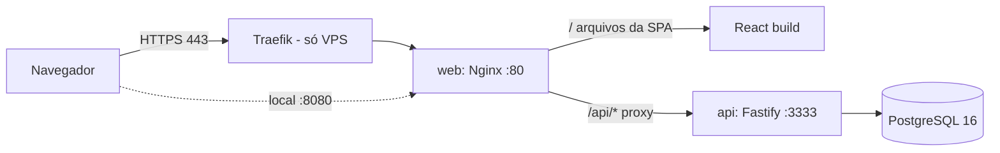
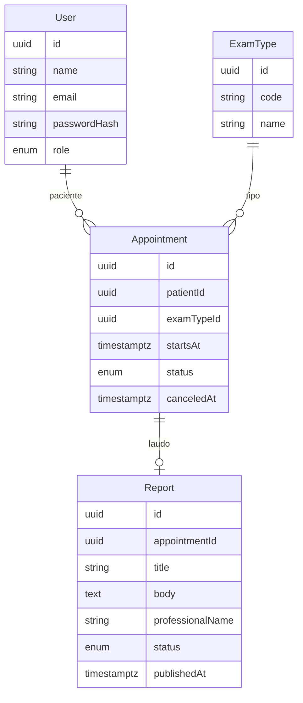

# Arquitetura — Dr. Laudo

**Referências:** [enunciado original](../teste-agendamento-exames-laudos.pdf) · [PRD — requisitos e regras de negócio](PRD.md) · [RULES — regras de implementação](RULES.md).

## 1. Visão geral



O Nginx serve a SPA e faz proxy de `/api` para a API. Front e API ficam na mesma origem: sem CORS, um único router no Traefik, comportamento igual em local e produção. O front sempre chama `/api/...` com URL relativa.

## 2. Estrutura de diretórios

```
agendamento-exames-laudos/
├── AGENTS.md · CLAUDE.md · README.md
├── .claude/{settings.json, commands/}
├── .github/{workflows/ci.yml, pull_request_template.md}
├── docker-compose.yml          # avaliador / dev
├── docker-compose.qa.yml       # testes isolados
├── docker-compose.prod.yml     # VPS + Traefik
├── .env.example · .env.prod.example · .gitattributes · .dockerignore
├── .dependency-cruiser.cjs · eslint.config.js · package.json
├── docker/postgres/init-test-db.sql
├── docs/
└── apps/
    ├── api/
    │   ├── Dockerfile · docker-entrypoint.sh
    │   ├── prisma/{schema.prisma, migrations/, seed.ts}
    │   ├── src/
    │   │   ├── app.ts · server.ts · env.ts · clock.ts
    │   │   ├── plugins/{auth.ts, errors.ts, prisma.ts}
    │   │   ├── domain/{slots.ts, time.ts, errors.ts}
    │   │   └── features/{auth, patients, exam-types, slots, appointments, reports, me}/
    │   └── tests/{helpers/, unit/, integration/}
    ├── web/
    │   ├── Dockerfile · nginx.conf · index.html
    │   ├── public/{favicon.svg, apple-touch-icon.png, og-image.png}
    │   └── src/
    │       ├── main.tsx · router.tsx
    │       ├── app/{store.ts, api.ts, authSlice.ts, filtersSlice.ts}
    │       ├── assets/brand/logo-mark.svg
    │       ├── styles/globals.css
    │       ├── lib/{time.ts, errors.ts, utils.ts}
    │       ├── components/{ui/, product/, brand/, layout/}
    │       └── features/{auth, agenda, appointments, reports, patient, status}/
    └── e2e/
        ├── Dockerfile · playwright.config.ts
        └── tests/{support/, auth.setup.ts, *.spec.ts}
```

## 3. Modelo de dados



```prisma
enum Role { STAFF PATIENT }
enum AppointmentStatus { SCHEDULED CANCELED }
enum ReportStatus { DRAFT PUBLISHED }

model User {
  id           String        @id @default(uuid()) @db.Uuid
  name         String
  email        String        @unique
  passwordHash String
  role         Role
  appointments Appointment[]
  createdAt    DateTime      @default(now()) @db.Timestamptz(3)
}

model ExamType {
  id           String        @id @default(uuid()) @db.Uuid
  code         String        @unique
  name         String
  appointments Appointment[]
}

model Appointment {
  id         String            @id @default(uuid()) @db.Uuid
  patientId  String            @db.Uuid
  examTypeId String            @db.Uuid
  startsAt   DateTime          @db.Timestamptz(3)
  status     AppointmentStatus @default(SCHEDULED)
  canceledAt DateTime?         @db.Timestamptz(3)
  createdAt  DateTime          @default(now()) @db.Timestamptz(3)
  patient    User              @relation(fields: [patientId], references: [id])
  examType   ExamType          @relation(fields: [examTypeId], references: [id])
  report     Report?
  @@index([startsAt])
  @@index([patientId])
}

model Report {
  id               String       @id @default(uuid()) @db.Uuid
  appointmentId    String       @unique @db.Uuid
  title            String
  body             String
  professionalName String
  status           ReportStatus @default(DRAFT)
  publishedAt      DateTime?    @db.Timestamptz(3)
  createdAt        DateTime     @default(now()) @db.Timestamptz(3)
  updatedAt        DateTime     @updatedAt @db.Timestamptz(3)
  appointment      Appointment  @relation(fields: [appointmentId], references: [id])
}
```

Migration manual (criada com `--create-only`):

```sql
CREATE UNIQUE INDEX "appointment_active_slot_unique"
  ON "Appointment" ("startsAt") WHERE "status" = 'SCHEDULED';
```

`Report.appointmentId @unique` garante RN-14 também no banco (`P2002` → `409 REPORT_EXISTS`).

## 4. Fluxo de uma requisição

`route` (Zod valida entrada → `authenticate` → `requireRole`) → `service` (regra + Prisma, usando `clock`) → `dto` (select/mapeamento) → resposta. `DomainError` e `ZodError` são convertidos pelo plugin `errors.ts`.

## 5. Concorrência

| Risco | Proteção |
|---|---|
| Dois agendamentos no mesmo slot | Índice único parcial + `P2002` → 409 |
| Dois laudos no mesmo agendamento | `@unique` em `appointmentId` + `P2002` → 409 |
| Cancelar × publicar simultâneos (write skew) | `$transaction` + `SELECT ... FOR UPDATE` no `Appointment` |
| Editar × publicar simultâneos | Mesma trava + verificação de status dentro da transação |

```ts
await prisma.$transaction(async (tx) => {
  await tx.$queryRaw`SELECT id FROM "Appointment" WHERE id = ${id}::uuid FOR UPDATE`;
  const appt = await tx.appointment.findUnique({ where: { id }, select: { status: true, report: { select: { status: true } } } });
  if (!appt) throw new DomainError('NOT_FOUND', 404);
  if (appt.status !== 'SCHEDULED' || appt.report?.status === 'PUBLISHED') throw new DomainError('CANNOT_CANCEL', 409);
  await tx.appointment.update({ where: { id }, data: { status: 'CANCELED', canceledAt: clock.now() } });
});
```

## 6. Autenticação e autorização

- `POST /auth/login` → JWT (`sub`, `role`, `name`, `iss: drlaudo-api`, 8h).
- O front guarda a sessão em `localStorage` (`drlaudo.session`) e a envia como `Authorization: Bearer` (trade-off em D-11).
- `authenticate` valida o token; `requireRole('STAFF')` protege as rotas de equipe.
- As rotas `/me/*` filtram sempre por `patientId = request.user.sub`, dentro do próprio `where` (não como checagem posterior).

## 7. Tempo

- Banco: `timestamptz`. API: ISO 8601 UTC (`2026-11-10T13:00:00.000Z`).
- `domain/slots.ts`: `generateDaySlots(date, tz)`, `isValidSlot(instant, tz)`, `isPast(instant, now)`. Validação no fuso da clínica com `@date-fns/tz` (não depender de offset fixo).
- Web: `lib/time.ts` formata sempre com `TZDate(..., 'America/Sao_Paulo')` e exibe "Horário de Brasília".

## 8. Frontend

- `app/api.ts`: RTK Query com tags `Appointment`, `Slot`, `Report`, `MyAppointment`. Mutações invalidam as tags certas (agendar → `Appointment`, `Slot`).
- Rotas: `/login`, `/agenda`, `/agendamentos/novo`, `/agendamentos/:id/laudo`, `/meus-exames`, `/meus-exames/:id/laudo`, `/_ds` (só dev).
- `<RequireRole role="STAFF">` / `<RequireRole role="PATIENT">` redirecionam para a home do perfil.

## 9. Seed

Idempotente (upsert): 1 usuário STAFF, 2 pacientes, 3 tipos de exame (Raio-X de tórax, Ultrassonografia de abdome, Ressonância de crânio), alguns agendamentos futuros e um laudo publicado + um rascunho para a demo. Datas relativas a `now` do seed.

## 10. Observabilidade

Logs estruturados (pino) com `reqId`. `GET /health` verifica a conexão com o banco (`SELECT 1`). `HEALTHCHECK` nos containers.

## 11. Modos de execução

| Modo | Comando | URL | Banco |
|---|---|---|---|
| Docker completo (avaliador) | `docker compose up --build` | http://localhost:8080 | container `db` (porta 5433 no host) |
| Híbrido | `docker compose up -d db` + `npm run dev` | :5173 (web) / :3333 (api) | `localhost:5433` |
| 100% local | `npm run db:setup && npm run dev` | :5173 / :3333 | Postgres local |
| QA isolado | `docker compose -f docker-compose.qa.yml run --rm api-test` / `e2e` | interno | tmpfs (`drlaudo-qa`) |
| Produção (VPS) | `docker compose -f docker-compose.prod.yml --env-file .env.prod up -d` | https://drlaudo.seudominio.com.br | volume, sem porta exposta |

## 12. Deploy na VPS

Traefik com HTTPS (Let's Encrypt). O `web` está nas redes `internal` + `traefik`; `api` e `db` só na `internal`. `TRUST_PROXY_HOPS=2` (Traefik + Nginx). Segredos em `.env.prod` fora do Git (`openssl rand -hex 32`). `noindex` via `X-Robots-Tag`. A migration roda no entrypoint (`prisma migrate deploy`). Smoke E2E contra a URL pública após o deploy.
