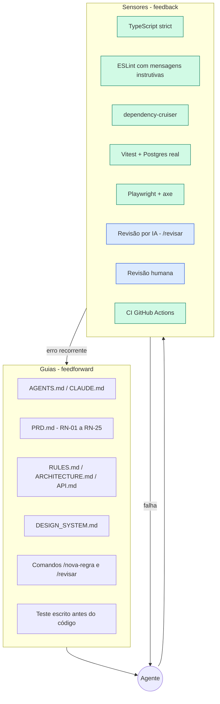
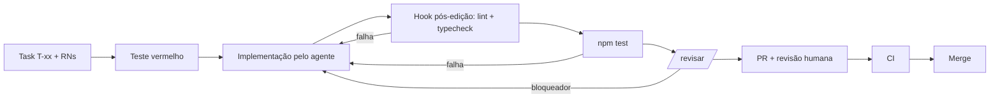

# Harness — como a IA trabalha neste projeto

**Referências:** [enunciado original](../teste-agendamento-exames-laudos.pdf) · [PRD — requisitos e regras de negócio](PRD.md) · [RULES — regras de implementação](RULES.md).

> Agente = Modelo + Harness. O harness é tudo em volta do modelo: o que o orienta antes de agir (**guias**) e o que o verifica depois (**sensores**).
> Referência: [Martin Fowler — Harness engineering](https://martinfowler.com/articles/harness-engineering.html)

## 1. Mapa



Verde = computacional (determinístico, barato, roda sempre). Azul = inferencial (julgamento, mais caro, roda no fim).

## 2. Inventário de controles

| Controle | Tipo | O que pega | Quando roda |
|---|---|---|---|
| `AGENTS.md` | Guia | Stack, invariantes, proibições | Início de toda sessão |
| `PRD.md` (RN-xx) | Guia | Comportamento esperado | Antes de cada task |
| Teste primeiro | Guia + sensor | Implementação que não cumpre a RN | Cada mudança |
| TypeScript strict | Sensor | Tipos, `undefined` em índice | Hook pós-edição, CI |
| ESLint | Sensor | `any`, hex solto, Prisma em route, `new Date()` em service | Hook pós-edição, CI |
| dependency-cruiser | Sensor | Violação de camadas | `check:arch`, CI |
| Vitest integração | Sensor | Regras, autorização, concorrência | `npm test`, CI |
| Playwright + axe | Sensor | Fluxo real, vazamento na UI, acessibilidade | `test:e2e`, CI |
| `/revisar` | Sensor inferencial | Invariantes semânticas | Antes do PR |
| Revisão humana | Sensor inferencial | Requisito mal entendido, overengineering | Todo PR |

## 3. Mensagens de lint escritas para o agente

A mensagem de erro é um prompt: ela diz o que fazer, não só o que está errado.

```js
// eslint.config.js (trecho)
'no-restricted-syntax': ['error',
  { selector: "Literal[value=/^#[0-9a-fA-F]{3,8}$/]",
    message: 'Hex solto proibido. Use token semântico (bg-primary, text-highlight-strong). Ver docs/DESIGN_SYSTEM.md §3.' },
  { selector: "NewExpression[callee.name='Date'][arguments.length=0]",
    message: 'Use clock.now() (injetável). new Date() em regra de negócio quebra testes de tempo. Ver RULES.md §6.' },
],
'no-restricted-imports': ['error', { patterns: [{ group: ['@prisma/client'], importNames: ['PrismaClient'],
    message: 'Route não acessa Prisma. Chame o service da feature. Ver RULES.md §2.' }] }],
```

## 4. Regras de arquitetura (`.dependency-cruiser.cjs`)

- `domain-is-pure`: `src/domain` não importa `fastify`, `@prisma/client` nem `src/features`.
- `service-no-http`: `*.service.ts` não importa `fastify`.
- `no-cross-feature`: uma feature não importa o service de outra (use `domain` ou mova o código).
- `web-ui-pure`: `components/ui` não importa `app/api`.

## 5. Ciclo de vida de uma mudança



O hook pós-edição está em `.claude/settings.json` (`PostToolUse` em `Edit|Write` roda lint e typecheck do workspace afetado).

## 6. Steering: erro vira regra

Quando o agente erra duas vezes da mesma forma, a correção não fica no chat. Ela vira guia ou sensor:

| Erro observado | Virou |
|---|---|
| Sugeriu SELECT antes do INSERT para conflito | Invariante 1 no `AGENTS.md` + teste do cenário 1 com `Promise.all` |
| Usou `updateMany` condicional achando que resolvia cancelar × publicar | Invariante 2 + teste de corrida + D-05 |
| Retornou `prisma.user.findMany()` sem select | Invariante 5 + teste que procura `passwordHash` em toda resposta |

O histórico completo fica em `AI_USAGE.md`.

## 7. Limites (o que os sensores não pegam)

- Requisito mal entendido: se o teste está errado, o código "certo" passa. Por isso os 5 cenários foram escritos pelo desenvolvedor e revisados linha a linha.
- Overengineering e abstração desnecessária: só a revisão humana pega.
- Teste fraco gerado por IA: só entra se foi visto falhar antes.
- UX ruim, mas acessível: axe não julga clareza; o checklist exploratório em `TESTING.md` cobre isso.
