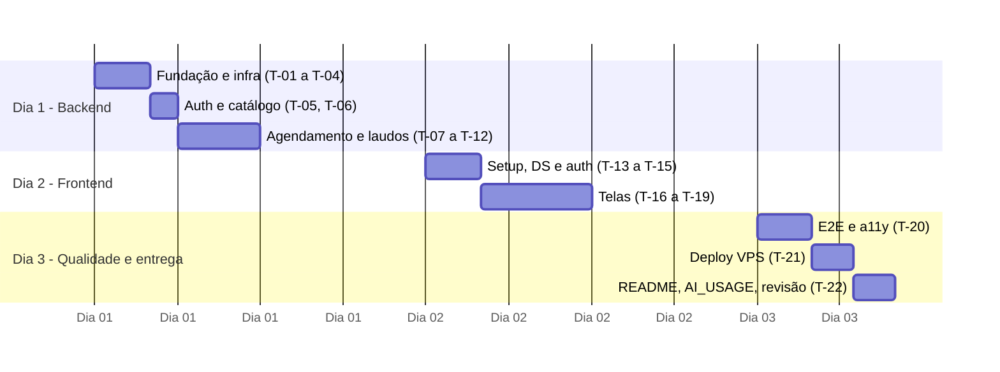

# Tasks — plano de 3 dias

**Referências:** [enunciado original](../teste-agendamento-exames-laudos.pdf) · [PRD — requisitos e regras de negócio](PRD.md) · [RULES — regras de implementação](RULES.md).

Regra de corte: se o prazo apertar, o deploy sai primeiro. **Os testes nunca saem.**

## Dia 1 — Backend

**T-01 Monorepo e tooling.** Workspaces, TS strict, ESLint (com mensagens do `HARNESS.md`), Prettier, dependency-cruiser, Vitest, `.claude/settings.json`.
AC: `npm run lint`, `typecheck` e `check:arch` rodam verdes no repositório vazio.

**T-02 Infra Docker e CI.** `docker-compose.yml`, `.qa.yml`, `.prod.yml`, Dockerfiles (api com stage `test`), `nginx.conf`, `init-test-db.sql`, `.gitattributes` (`*.sh eol=lf`), `ci.yml`.
AC: `docker compose up -d db` sobe; o CI roda lint + typecheck + test em um PR.

**T-03 App Fastify.** `env.ts` (Zod), `clock.ts`, plugin de erros, `GET /health`, pino.
AC: env inválido derruba o boot com mensagem clara; `/health` → 200; erro desconhecido → 500 no formato padrão.

**T-04 Prisma.** Schema, migration com índice parcial, seed idempotente.
AC: `npm run db:setup` roda 2× sem erro; o índice existe (`\d "Appointment"`).

**T-05 Auth.** Login, JWT, `authenticate`, `requireRole`, rate limit, `/auth/me`. RN-01..03.
AC: testes de 200/401/403/429; nenhuma resposta contém `passwordHash`.

**T-06 Catálogo.** `GET /patients`, `GET /exam-types`.
AC: só STAFF; DTO enxuto.

**T-07 Domínio de slots.** `generateDaySlots`, `isValidSlot`, `isPast`. RN-06..08, RN-25.
AC: unitários verdes, incluindo a virada de data em UTC.

**T-08 Criar agendamento.** `POST /appointments`. RN-06..10.
AC: **cenário 1** e **cenário 5** verdes; `INVALID_SLOT` coberto; slot cancelado pode ser reagendado.

**T-09 Agenda e slots.** `GET /appointments` com filtros, `GET /slots`.
AC: `?date=` respeita o dia de São Paulo; slots com `reason`.

**T-10 Cancelar.** RN-11..13, com `FOR UPDATE`.
AC: `CANNOT_CANCEL` nos dois casos; o rascunho permanece.

**T-11 Laudos.** Criar, editar, publicar. RN-14..21.
AC: todos os 409 cobertos; teste de corrida cancelar × publicar (20×) nunca gera estado inválido.

**T-12 Portal do paciente (API).** `/me/appointments`, `/me/appointments/:id/report`. RN-22..24.
AC: **cenários 2, 3 e 4** verdes; 404 com corpo idêntico nos 4 casos.

## Dia 2 — Frontend

**T-13 Setup web.** Vite, Tailwind v4, shadcn, `globals.css`, fontes, logo, favicon, `/_ds`.
AC: `/_ds` mostra todos os tokens e componentes; zero hex no JSX.

**T-14 Store e login.** RTK Query, `authSlice` (persistido em `drlaudo.session`), tela de login com atalhos demo, 401 → logout.
AC: login redireciona por perfil; sessão sobrevive ao F5.

**T-15 Layout e rotas.** AppShell, `RequireRole`, header com logo/usuário/sair, rodapé obrigatório.
AC: paciente em rota de equipe vai para `/meus-exames`, e vice-versa.

**T-16 Agenda.** Filtros (data/paciente) na URL, tabela/cards, `StatusBadge`, cancelar com AlertDialog.
AC: o cancelamento atualiza a lista sem reload.

**T-17 Novo agendamento.** Formulário + Calendar + `SlotGrid`.
AC: o tratamento de `SLOT_TAKEN` atualiza a grade e mostra o toast; slots passados ficam desabilitados com motivo.

**T-18 Laudo (equipe).** `ReportEditor`, salvar rascunho, `PublishDialog`, modo somente leitura após publicar.
AC: os campos respeitam RN-16 no cliente; não há edição depois de publicado.

**T-19 Portal do paciente.** Lista mobile-first, "Laudo disponível", `ReportViewer`, `TimezoneNote`.
AC: nenhum indício de rascunho; URL de outro paciente → "Não encontramos este registro".

## Dia 3 — Qualidade e entrega

**T-20 E2E.** Playwright + axe conforme `TESTING.md` §6, rodando em Docker.
AC: `docker compose -f docker-compose.qa.yml run --rm e2e` verde; a11y sem violações.

**T-21 Deploy na VPS.** `.env.prod`, Traefik, HTTPS, `noindex`, smoke.
AC: URL pública funcionando; smoke verde.

**T-22 Entrega.** README final (prints, URL), `AI_USAGE.md` com histórico e tempo aproximado dedicado ao exercício, contraste medido, checklist exploratório, `/revisar` no diff completo.
AC: um clone limpo em outra máquina roda demo e testes seguindo só o README; todos os itens do §5 do [enunciado original](../teste-agendamento-exames-laudos.pdf) estão presentes, incluindo exemplo de variáveis de ambiente sem segredos, decisões, limitações, pendências e tempo dedicado.
